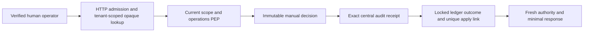

# WP-108 — verified operator HTTP recovery

The optional operator boundary now connects real HTTP requests to the retained
`ManualEffectResolver`. It adds paged unknown-effect discovery for one verified tenant and
registry instance, plus an idempotent resolution route. Public identifiers are canonical key
fingerprints. Responses contain no raw thread/node/idempotency key, target, detail or credential.

`ManualEffectsResource` obtains `CallerAuthority` through the existing JWT caller resolver before
checking activation. Anonymous requests therefore receive 401 even while disabled; a verified
caller receives 404 until activation. `ManualEffectOperations` requires a current USER token,
`oa.recover` and the existing operations `RESOLVE_EFFECT` PEP. It rechecks authority and policy
after storage and before response. The resolver independently checks retained provenance,
request identity, authority and policy before central append and outcome application.

The service constructs a co-located audited ledger and central append consumer with the real
transaction manager. It does not change the legacy ledger bean or automatically resume a Flow
instance. It never invokes an external target. Existing manual-decision/application semantics
remain authoritative: the central request audit records an intent, a separate immutable apply
link records the mutation, and a late refusal cannot roll back committed history. Exact retries
reuse the caller-bound request id; changed actor or content conflicts.

The new setting defaults to false. An enabled service checks required V80 columns can be read at
startup. No SQL is installed automatically, no applied migration is changed, and other proposed
schemas remain inactive. The check is not a full DDL or role attestation. The
[deployment/API guide](../../../deploy/manual-effect-operator-api.md) documents the exact routes,
reason/state pairs, retry behavior, activation prerequisites and security boundaries.

## Author checks

The final Linux Java 21/PostgreSQL 16.15 run passed 40 tests in nine XML suites, with zero
failures, errors or skips. Nine final copied Java/configuration source files match this branch
after line-ending normalization; the copied V80 SQL also matches the unchanged proposal.

- Six HTTP cases exercise opaque output, exact retries and actor conflicts, signed caller
  scope/type and tenant refusals, three-page iteration, central audit failure and recovery,
  two concurrent identical requests, and token expiry during a six-second central audit delay.
- An unavailable-policy profile returns 503 before retaining/applying a manual decision.
- The disabled API still requires authentication and exposes no operation to verified callers.
- The existing route-discovery test finds the new endpoints and confirms anonymous 401 behavior.
- Existing resolver/migration cases pass, including retained audit/provenance, JTA, restricted
  role and uncertain-result behavior. Contract/runtime/policy architecture cases also pass.

All 91 Python tooling cases, generated-document checks, dependency policy, compose and deployment
guide links pass. Exact command, report/log/source digests and boundaries are in the
[local verification manifest](evidence/WP-108-manual-operator-api/local-verification.json).

The isolated Linux build used main `1a8716d3` plus this increment. The branch subsequently
incorporates the merged local-broker correction (`56f33946`); its production changes do not alter
the increment's nine verified source copies. A full combined-tree author CI pass remains required.

## Remaining work

This connects the missing operator API and existing policy/central-audit consumer. It does not
complete WP-108/T03. The issuer is a fake serving real signed test JWTs/JWKS, the target intent is
a fixture, and V80 is explicitly applied only to private test databases. A reviewed V80
installation/upgrade plan, deployed least-privilege roles, real-Keycloak route evidence,
cross-process HTTP recovery and governed Flow continuation remain open. Production identity,
approved target/provider sources and automatic effect-aware Flow recovery remain required.
No production switch, package or acceptance status is promoted. Independent final project
review remains deferred under the delivery agreement.
