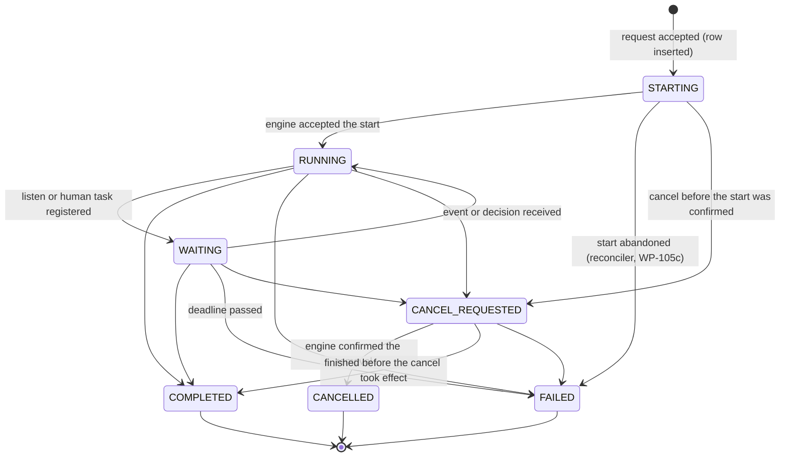
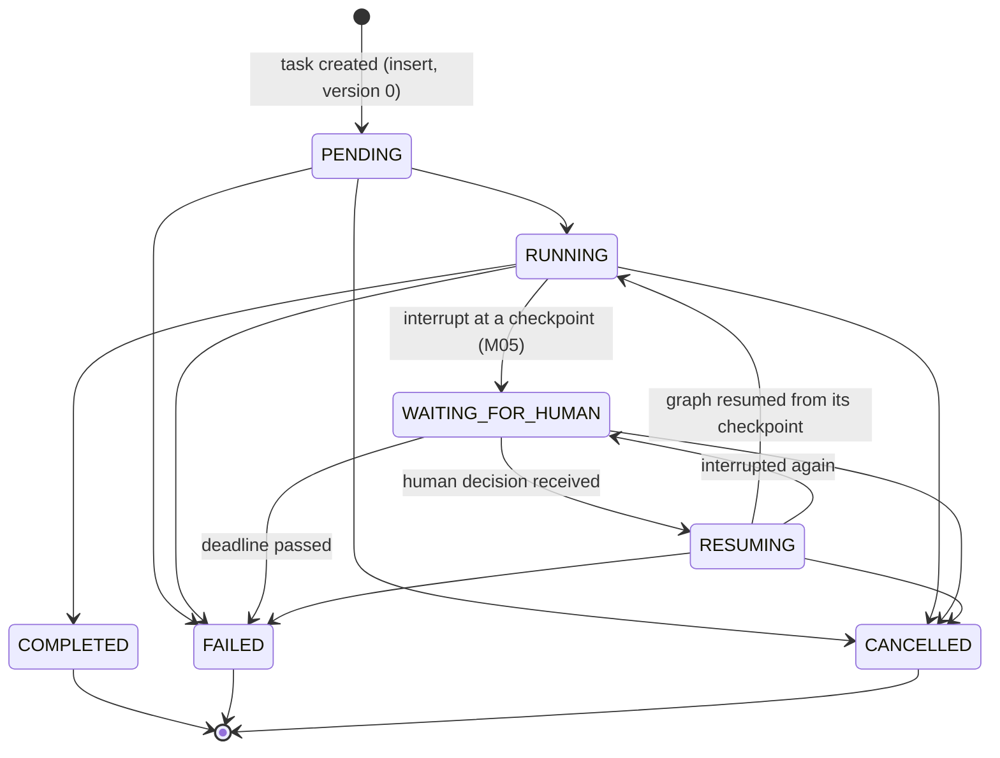
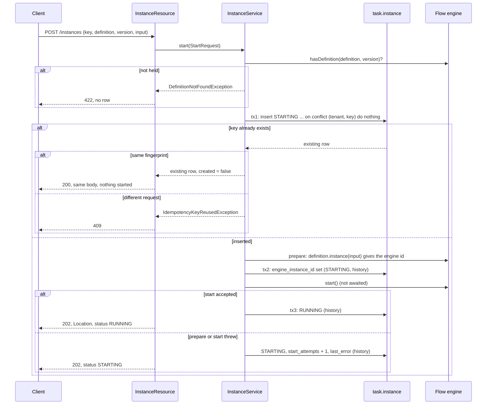

# Run lifecycle and the instance registry (WP-105, slice 105a)

**Status:** WP-105a implemented · **Decisions:** [ADR 0019](adr/0019-how-workflow-instances-are-started-queried-cancelled-and-resumed.md), [ADR 0020](adr/0020-checkpoint-scoping-and-state-evolution.md), [ADR 0023](adr/0023-workflow-to-agent-bridge.md) · **Plan:** [section 2, canonical progress](plan/README.md)

This slice makes the platform's own record of a run authoritative for lifecycle status, definition version and request idempotency. Quarkus Flow executes the pinned definition; it is not the record of what was asked for or what state the run is in. Slices 105b (outbox and projection), 105c (reconciler) and 105d (operations API) are not built here. Section 6 lists the seams they use.

## 1. Tables (schema `task`, migrations V10 to V13)

| Table | Row | Notes |
|---|---|---|
| `task.instance` | One workflow instance | Id is our ULID. Unique `(tenant, idempotency_key)` and unique `engine_instance_id`. Index on `(status, updated_at)` for the reconciler. |
| `task.agent_task` | One agent task (ownership row, ADR 0020) | Id is the task contract id. Unique `thread_name` (the derived `ThreadId`). FK to the instance. Holds the contract as JSON. `graph_version`, `state_schema_version` and `latest_checkpoint_id` are nullable and written by later slices. |
| `task.instance_event` | One history row per change of an instance | Primary key `(instance_id, version)`. `version` is the row version after the change, so history runs 0, 1, 2 with no gaps. |
| `task.agent_task_event` | One history row per change of an agent task | Same shape, keyed by `(agent_task_id, version)`. |

Every row has a `version` for optimistic locking. Both event tables are **append-only in the database**: a trigger refuses `UPDATE`, `DELETE` and `TRUNCATE` for any role (V13). A history row is written in the same transaction as the change it records.

Columns of `task.instance`: `id`, `tenant`, `owner_kind`, `owner_id`, `idempotency_key`, `request_fingerprint` (SHA-256 of the definition id, version and canonical input), `definition_id` (`namespace/name`), `definition_version`, `input` (JSON, at most 64 KiB), `status`, `engine_instance_id`, `start_attempts`, `last_error` (exception class name, never its message), `wait_deadline` (nullable, ADR 0019 Deadlines), `version`, `created_at`, `updated_at`.

## 2. State machines

Both are pure code in `io.github.bassemzohdy.openworkflow.agentic.runtime.lifecycle` (`InstanceStateMachine`, `AgentTaskStateMachine`). An illegal change throws `IllegalTransitionException`. A terminal state has no exit. A change that keeps the same status is not a transition: the store records it in history with `from` equal to `to` (used for a failed start attempt and for the engine id). `StateMachineTest` checks every pair of states against the edge list written out as literals.

### 2.1 Instance (registry) status

| State | Meaning |
|---|---|
| `STARTING` | Registered. The engine has not confirmed the start. A failed attempt keeps the row here with `start_attempts` and `last_error`. |
| `RUNNING` | The engine accepted the start. Waiting and completion are reported by the engine observer (105b). |
| `WAITING` | The instance waits for an event or a human decision. Written by 105b. |
| `CANCEL_REQUESTED` | A cancel was asked for; the engine removal is asynchronous (WP-003 Q05). |
| `CANCELLED`, `COMPLETED`, `FAILED` | Terminal. |

### 2.2 Agent task status

The contract's `AgentTaskStatus` names the states. `PENDING` is the created state and the only one a new row may have. `RESUMING` was added for ADR 0023 decision 7; `WAITING_FOR_HUMAN` keeps the name the contract already uses.

Why these states. `RESUMING` separates "interrupted, waiting for a decision" from "resumed and executing", so the reconciler can restart a resumed run after a crash without confusing it with a waiting one (ADR 0023). `WAITING_FOR_HUMAN` is entered only from `RUNNING` because an interrupt happens inside a step. `PENDING` has no direct edge to `WAITING_FOR_HUMAN` or `COMPLETED`: a task must run before it can wait or finish.

## 3. Start sequence (ADR 0019, Start)

Points that matter:

- **One engine start per key.** Only the request whose insert succeeded calls the engine. Concurrent identical requests wait on the unique key and then see the row. `ConcurrentStartTest` runs twenty threads through a barrier and asserts one row, one prepare, one start and three history rows.
- **The engine id is recorded before the engine runs anything.** `definition.instance(input)` already has the id, so tx2 stores it before `start()`. A crash after `start()` therefore leaves a row that names the engine instance the engine may already have persisted.
- **Our id, not the engine's.** The external instance id is our ULID, generated before the engine is involved, so that the idempotent insert can happen first. The engine id is kept in `engine_instance_id`. ADR 0019 says the engine's id is the external id; see section 7.
- **Start never waits.** `start()` is called and its future is not awaited. The request returns when the engine has accepted the instance.
- **Reads come from the registry only.** `GET /instances/{id}` never reads the Flow tables and returns 404 for another tenant's id.

## 4. REST contract

| Request | Response |
|---|---|
| `POST /instances` with `{definitionId, definitionVersion, input, idempotencyKey}` and headers `X-Tenant`, `X-Subject` | 202 and `Location` for a new instance; 200 with the same body for a repeated key; 409 for a key used with a different request; 422 unknown definition; 400 malformed; 401 no caller |
| `GET /instances/{id}` | 200 with `{id, definitionId, definitionVersion, status, engineInstanceId, startAttempts, version, createdAt, updatedAt}`; 404 unknown, malformed or another tenant's id; 401 no caller |

Errors are RFC 9457 problem documents with the correlation id. The caller comes from `CallerContextResolver`. It reads `X-Tenant` and `X-Subject` only when `agentic.dev.trust-caller-headers=true`. The default is false, so every instance endpoint answers 401 until WP-102 provides authentication. The flag must not be enabled in a deployment.

## 5. Failure modes

| Failure | What is stored | What happens next | Covered by |
|---|---|---|---|
| Definition not held by the engine | Nothing | 422; no row | `InstanceApiTest.anUnknownDefinitionIsRejectedAndNoRowIsCreated` |
| Same key, different request | Nothing changes | 409 | `InstanceApiTest.theSameKeyForADifferentRequest...` |
| Two identical requests at once | One row | One start; the other gets 200 | `ConcurrentStartTest` |
| Engine `prepare` throws | Row `STARTING`, attempt 1, `last_error` class, no engine id | 202 with `STARTING`. Repeats do not retry. The reconciler finds the row (WP-105c) | `EngineFailureTest` |
| Engine `start` throws | Row `STARTING`, engine id set, attempt 1, `last_error` | Same. The engine may have persisted the instance, so the reconciler must check before it starts again | `EngineFailureTest` |
| Registry write fails before the engine is prepared | Row `STARTING` may exist with no engine id, or no row | The response is 500 with the correlation id. The reconciler can find a `STARTING` row with no engine id and prepare it | not tested (fault injection, WP-110 and later) |
| Crash between tx2 and `start()` | `STARTING` with engine id, Flow has no instance | Reconciler starts the prepared instance by id rather than preparing a new one | not built (105c) |
| Crash after `start()` but before tx3 | `STARTING` with engine id, Flow may have persisted it | Reconciler checks the engine and sets `RUNNING`, or starts it. It must never call `prepare` again for that row | not built (105c) |
| Illegal status change | Nothing | `IllegalTransitionException`, no history row | `InstanceApiTest.anIllegalTransitionIsRejected...` |
| Stale version | Nothing | `StaleVersionException`, reload and decide again | `InstanceApiTest.aStaleVersionIsRejected...` |
| Edit of history | Refused by trigger | SQL error | `InstanceApiTest.historyIsAppendOnlyInTheDatabase` |
| Another tenant reads an id | Nothing | 404; the id is not revealed | `InstanceApiTest.anotherTenant...` |

Failure of a registry write after a successful engine start is the case that needs the reconciler most. The engine then runs an instance the registry does not show as running. That gap is closed in 105c, and until then the row stays `STARTING`, which is visible to any reader.

## 6. What slices 105b, 105c and 105d must add

Seams that exist now:

- `InstanceStore.replace` and `TaskStore.replace` are the only write paths. Each guards identity, version and transitions, and writes history in the same transaction.
- `JdbcTaskStore` implements `TaskStore`, so the runtime's ownership check is `findByThread` before any read, write or resume.
- `FlowWorkflowEngine` is the only class that calls Flow for start. Query and cancel for Flow go through the same adapter.
- The index `instance_status_updated_idx` supports the reconciler's scans.

**105b (outbox and projection)**
- Engine observer: write `WAITING`, `COMPLETED`, `FAILED` and `RUNNING` (resume) from engine events. No code in 105a writes these edges. They are in the state machine already.
- Transactional outbox: a row written in the same transaction as each history row. The writer is `JdbcInstanceStore.replace` and `JdbcTaskStore.replace`. Add a hook to the transaction so the outbox row and the history row commit together. 105a does not add it.
- `task_view` projection fed from the outbox, redelivered until acknowledged. The projection is never a source of truth.

**105c (reconciler)**
- Wait for definition warm-up at startup. Then, periodically and at startup: rows `STARTING` older than a threshold; rows `RUNNING` or `WAITING` whose engine instance is not active in memory, started through `activeInstance(id)` and `start()` (ADR 0019, resume; WP-003 Q02, Q11); rows `CANCEL_REQUESTED` that are stuck; `wait_deadline` passed.
- Agent runs in `RUNNING` or `RESUMING` restarted by the reconciler (ADR 0023, decision 7). Bridge A runs are restarted by the workflow instead.
- Every repair is audited. A repair never calls `prepare` for a row that has an engine id.
- Retries: set `quarkus.flow.http.client.resilience.retry.max-retries=0` (ADR 0019 Retries, ADR 0023 decision 3). Not done in 105a; it changes the behavior of the shipped definition's HTTP call and belongs with the reconciler's tests.

**105d (operations API)**
- Inspect, cancel, retry, pause and recover, authorized. Cancel moves `RUNNING` or `WAITING` to `CANCEL_REQUESTED`; retry applies to `STARTING` rows and the agent task states that allow it. Each call writes history with the operator as actor.
- Authorization depends on WP-102. Until then the endpoints are not exposed.

**Outside the four slices but needed by the plan**
- The code that inserts `agent_task` rows and sets `graph_version` and `state_schema_version` (WP-201, WP-302). `AgentTaskRecord` has no pinning fields, so the columns are written by SQL there, or the record is extended with a decision.
- Owner-scoped reads (who may read which instance). WP-102.

## 7. Deviations and open points for the owner

These are not ADR edits. The ADRs were left unchanged, as the brief asks.

1. **Our id, not the engine's, is the external id.** ADR 0019 says "The instance id is the engine's monotonic ULID, which we keep as the external id". The start has to insert a row before the engine is prepared so that the idempotency key is decided first, so the external id is ours. The engine id is stored in `engine_instance_id`. The owner should confirm this and amend ADR 0019.
2. **Engine id recorded before `start()`.** ADR 0019 Start lists the steps as insert, start, then record the id and set RUNNING. The Flow API gives the id from `definition.instance(input)`, before `start()`. Recording it first closes a gap after a crash. This is a refinement of the ADR's order.
3. **Query scope.** ADR 0019 says "a query by id is scoped by definition id and version; an id alone is not a valid key". With a platform ULID the id is unique on its own. `GET /instances/{id}` is scoped by tenant. Whether version scoping is still wanted needs a decision. Version pinning is recorded on the row either way.
4. **Input stored inline.** ADR 0019 allows "input reference or input". The input is stored inline as `jsonb`, limited to 64 KiB. Larger inputs need a reference, which is a later decision.
5. **Failed start is not `FAILED`.** A failed attempt stays `STARTING`. ADR 0019 does not say what happens after repeated failures. The state machine allows `STARTING -> FAILED`, reserved for the reconciler after it gives up.
6. **Pinning fields absent from `AgentTaskRecord`.** ADR 0020 decision 4 requires the agent task to record graph version and state schema version. The columns exist; the record in `oa-contracts` does not carry them. Adding them changes a public record, so this was not done in 105a.
7. **Retry configuration not applied.** ADR 0019 and ADR 0023 require the Flow HTTP client retry to be zero. Not configured in 105a (section 6).
8. **`RESUMING` added to `AgentTaskStatus`.** ADR 0023 uses the state name. The contract enum did not have it. It is additive, and no existing use changes.

## 8. Not verified

- No fault injection of a registry write between the engine call and the database; the failure rows are produced by the engine test double only.
- The real engine is used for start only. Whether the registry reflects the engine's later states is not tested, because 105b does not exist yet.
- The concurrency test uses twenty threads against one Postgres database on one machine; it shows the unique key works, not behavior under a multi-node deployment.
