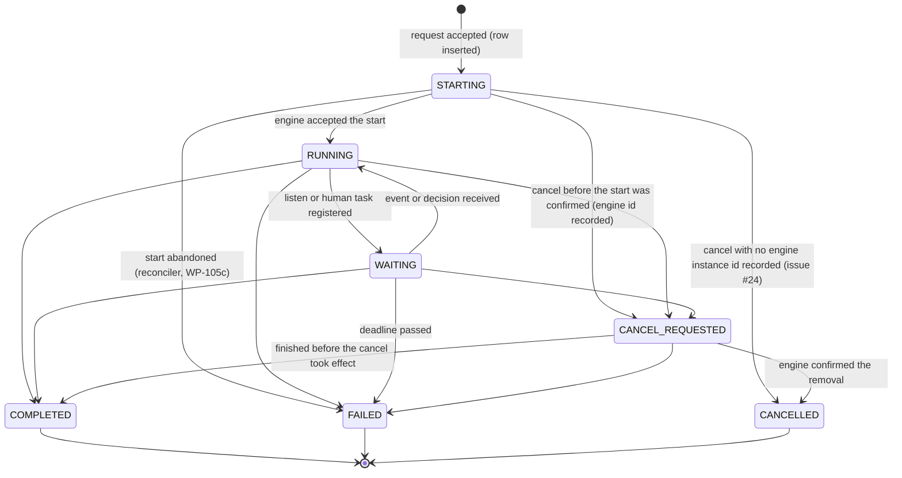
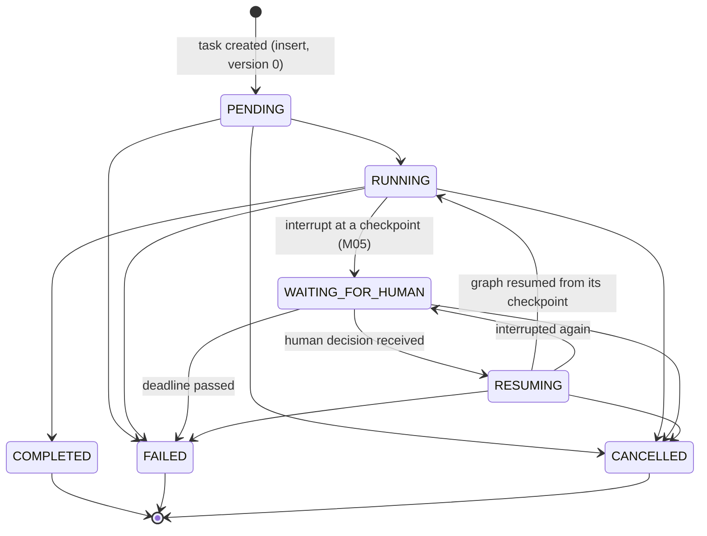
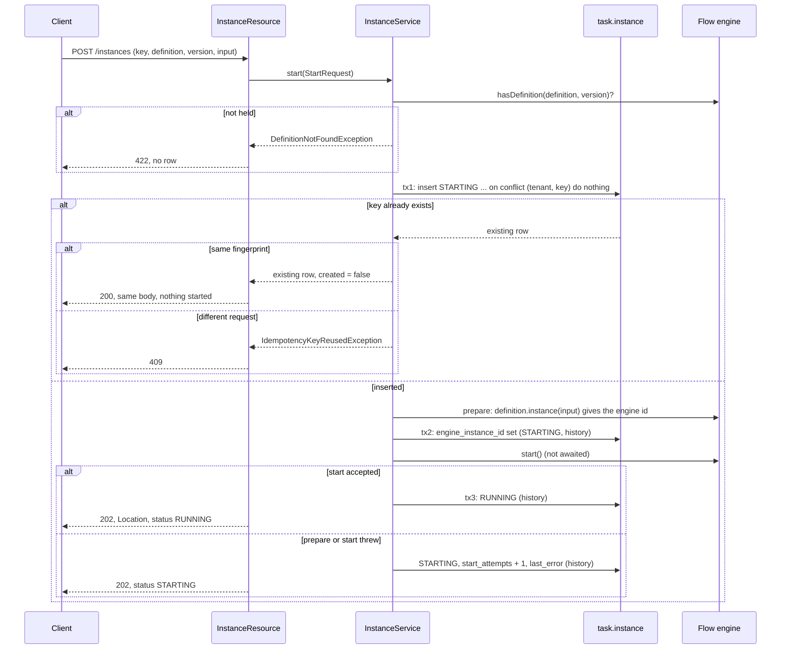
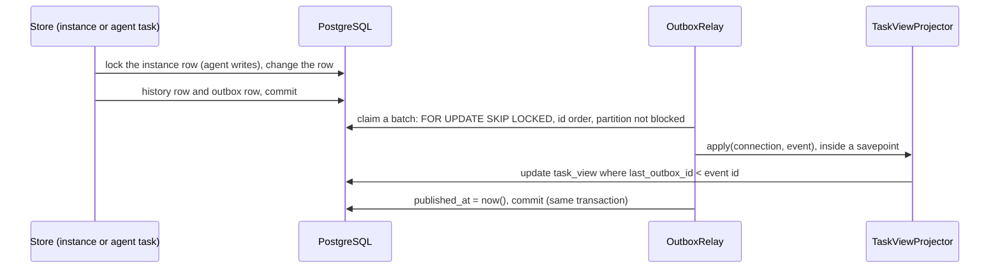

# Run lifecycle and the instance registry (WP-105, slice 105a)

**Status:** WP-105a, WP-105b, WP-105c and WP-105d implemented (the reconciler is section 9, the outbox and projection are section 10, the operations API is section 11) · **Decisions:** [ADR 0019](adr/0019-how-workflow-instances-are-started-queried-cancelled-and-resumed.md), [ADR 0020](adr/0020-checkpoint-scoping-and-state-evolution.md), [ADR 0023](adr/0023-workflow-to-agent-bridge.md) · **Plan:** [section 2, canonical progress](plan/README.md)

This slice makes the platform's own record of a run authoritative for lifecycle status, definition version and request idempotency. Quarkus Flow executes the pinned definition; it is not the record of what was asked for or what state the run is in. The reconciler (105c) is section 9; the outbox and projection (105b) are section 10; the operations API (105d) is section 11. Section 6 lists the seams they use.

## 1. Tables (schema `task`, migrations V10 to V13)

| Table | Row | Notes |
|---|---|---|
| `task.instance` | One workflow instance | Id is our ULID. Unique `(tenant, idempotency_key)` and unique `engine_instance_id`. Index on `(status, updated_at)` for the reconciler. `retried_from` (V50, nullable, a foreign key to the same table, indexed) names the FAILED instance this one retries. A partial unique index allows at most one non-terminal retry per failed instance (section 11.3). |
| `task.agent_task` | One agent task (ownership row, ADR 0020) | Id is the task contract id. Unique `thread_name` (the derived `ThreadId`). FK to the instance. Holds the contract as JSON. `graph_version`, `state_schema_version` and `latest_checkpoint_id` are nullable and written by later slices. |
| `task.instance_event` | One history row per change of an instance | Primary key `(instance_id, version)`. `version` is the row version after the change, so history runs 0, 1, 2 with no gaps. |
| `task.agent_task_event` | One history row per change of an agent task | Same shape, keyed by `(agent_task_id, version)`. |

Every row has a `version` for optimistic locking. Both event tables are **append-only in the database**: a trigger refuses `UPDATE`, `DELETE` and `TRUNCATE` for any role (V13). A history row is written in the same transaction as the change it records.

Columns of `task.instance`: `id`, `tenant`, `owner_kind`, `owner_id`, `idempotency_key`, `request_fingerprint` (SHA-256 of the definition id, version and canonical input), `definition_id` (`namespace/name`), `definition_version`, `input` (JSON, at most 64 KiB), `status`, `engine_instance_id`, `start_attempts`, `last_error` (exception class name, never its message), `wait_deadline` (nullable, ADR 0019 Deadlines), `version`, `created_at`, `updated_at`.

## 2. State machines

Both are pure code in `io.github.bassemzohdy.openworkflow.agentic.runtime.lifecycle` (`InstanceStateMachine`, `AgentTaskStateMachine`). An illegal change throws `IllegalTransitionException`. A terminal state has no exit. A change that keeps the same status is not a transition: the store records it in history with `from` equal to `to` (used for a failed start attempt and for the engine id). `StateMachineTest` checks every pair of states against the edge list written out as literals.

### 2.1 Instance (registry) status

| State | Meaning |
|---|---|
| `STARTING` | Registered. The engine has not confirmed the start. A failed attempt keeps the row here with `start_attempts` and `last_error`. |
| `RUNNING` | The engine accepted the start. Waiting and completion are reported by the engine observer (105b). |
| `WAITING` | The instance waits for an event or a human decision. Written by 105b. |
| `CANCEL_REQUESTED` | A cancel was asked for; the engine removal is asynchronous (WP-003 Q05). |
| `CANCELLED`, `COMPLETED`, `FAILED` | Terminal. `CANCELLED` comes from `CANCEL_REQUESTED` on the engine's report, or directly from `STARTING` when no engine instance id is recorded (`InstanceStateMachine`; the store checks the engine id rule on every write). A `FAILED` row is never reopened: a retry creates a new instance linked to it (section 11.3). |

### 2.2 Agent task status

The contract's `AgentTaskStatus` names the states. `PENDING` is the created state and the only one a new row may have. `RESUMING` was added for ADR 0023 decision 7; `WAITING_FOR_HUMAN` keeps the name the contract already uses.

Why these states. `RESUMING` separates "interrupted, waiting for a decision" from "resumed and executing", so the reconciler can restart a resumed run after a crash without confusing it with a waiting one (ADR 0023). `WAITING_FOR_HUMAN` is entered only from `RUNNING` because an interrupt happens inside a step. `PENDING` has no direct edge to `WAITING_FOR_HUMAN` or `COMPLETED`: a task must run before it can wait or finish.

## 3. Start sequence (ADR 0019, Start)

Points that matter:

- **One engine start per key.** Only the request whose insert succeeded calls the engine. Concurrent identical requests wait on the unique key and then see the row. `ConcurrentStartTest` runs twenty threads through a barrier and asserts one row, one prepare, one start and three history rows.
- **The engine id is recorded before the engine runs anything.** `definition.instance(input)` already has the id, so tx2 stores it before `start()`. A crash after `start()` therefore leaves a row that names the engine instance the engine may already have persisted.
- **Our id, not the engine's.** The external instance id is our ULID, generated before the engine is involved, so that the idempotent insert can happen first. The engine id is kept in `engine_instance_id`. ADR 0019, amended on 2026-10-19, makes our ULID the external id; see section 7.
- **Start never waits.** `start()` is called and its future is not awaited. The request returns when the engine has accepted the instance.
- **A cancel before the engine id is recorded is final.** A `STARTING` row with no engine instance id goes to `CANCELLED` directly (section 11.3). The start's own write of the engine id is a version change, so a start that loses the race to the cancel does not run the prepared instance; the response reports the row as the operator left it.
- **Reads come from the registry only.** `GET /instances/{id}` never reads the Flow tables and returns 404 for another tenant's id.

## 4. REST contract

| Request | Response |
|---|---|
| `POST /instances` with `{definitionId, definitionVersion, input, idempotencyKey}` and headers `X-Tenant`, `X-Subject` | 202 and `Location` for a new instance; 200 with the same body for a repeated key; 409 for a key used with a different request; 422 unknown definition; 400 malformed; 401 no caller |
| `GET /instances/{id}` | 200 with `{id, definitionId, definitionVersion, status, engineInstanceId, startAttempts, version, createdAt, updatedAt}`; 404 unknown, malformed or another tenant's id; 401 no caller |

Errors are RFC 9457 problem documents with the correlation id. The caller comes from `CallerContextResolver`. It reads `X-Tenant` and `X-Subject` only when `agentic.dev.trust-caller-headers=true`. The default is false, so every instance endpoint answers 401 until WP-102 provides authentication. The flag must not be enabled in a deployment.

## 5. Failure modes

| Failure | What is stored | What happens next | Covered by |
|---|---|---|---|
| Definition not held by the engine | Nothing | 422; no row | `InstanceApiTest.anUnknownDefinitionIsRejectedAndNoRowIsCreated` |
| Same key, different request | Nothing changes | 409 | `InstanceApiTest.theSameKeyForADifferentRequest...` |
| Two identical requests at once | One row | One start; the other gets 200 | `ConcurrentStartTest` |
| Engine `prepare` throws | Row `STARTING`, attempt 1, `last_error` class, no engine id | 202 with `STARTING`. Repeats do not retry. The reconciler finds the row (WP-105c) | `EngineFailureTest` |
| Engine `start` throws | Row `STARTING`, engine id set, attempt 1, `last_error` | Same. The engine may have persisted the instance, so the reconciler must check before it starts again | `EngineFailureTest` |
| Registry write fails before the engine is prepared | Row `STARTING` may exist with no engine id, or no row | The response is 500 with the correlation id. The reconciler can find a `STARTING` row with no engine id and prepare it | not tested (fault injection, WP-110 and later) |
| Crash between tx2 and `start()` | `STARTING` with engine id, Flow has no instance | The engine id cannot be prepared again, and nothing in memory can be started. Each pass counts an attempt; at the limit the row is `FAILED` (`start.exhausted`) and the client resubmits with a new key. Section 9 | `ReconcilerRepairTest.aStartingRowTheEngineNeverHeardOfIsFailedAfterTheLimit` |
| Crash after `start()` but before tx3 | `STARTING` with engine id, Flow may have persisted it | Reconciler checks the engine. A running instance moves the row to `RUNNING`; a pending one is started. It never calls `prepare` again for that row | `ReconcilerRepairTest.aStartingRowTheEngineHoldsAsPendingIsStartedWithoutAnEpochChange` |
| Illegal status change | Nothing | `IllegalTransitionException`, no history row | `InstanceApiTest.anIllegalTransitionIsRejected...` |
| Stale version | Nothing | `StaleVersionException`, reload and decide again | `InstanceApiTest.aStaleVersionIsRejected...` |
| Edit of history | Refused by trigger | SQL error | `InstanceApiTest.historyIsAppendOnlyInTheDatabase` |
| Another tenant reads an id | Nothing | 404; the id is not revealed | `InstanceApiTest.anotherTenant...` |
| Cancel of a `STARTING` row with no engine id | Row `CANCELLED` with history and outbox row, operator as actor | Start that prepared at the same moment is not run; a racing cancel that read an older version gets 409 `stale` | `RetryAndDirectCancelTest.aCancelOfAStartingRowWithNoEngineIdGoesStraightToCancelled`, `OperationsConcurrencyTest.aCancelThatLandsWhileTheStartIsPreparedStopsTheStartBeforeItRuns`, `ReconcilerRepairTest.aRowCancelledWhileThePreparedInstanceIsBeingMadeIsNeverStarted` |
| Cancel of a `STARTING` row with an engine id | `CANCEL_REQUESTED` with the operator's history row | The reconciler sends the engine cancel; `CANCELLED` only on the engine's report | `RetryAndDirectCancelTest.aCancelOfAStartingRowWithAnEngineIdStillGoesThroughCancelRequested` |
| Retry of a `FAILED` row | Failed row unchanged; new row with `retried_from` and the operator's history row | New instance started through the normal start path; response names both ids | `RetryAndDirectCancelTest.aRetryOfAFailedInstanceCreatesALinkedInstanceWithTheSameDefinitionAndInput` |
| Repeat of the same retry call | Nothing new | Same new instance; nothing started again | `RetryAndDirectCancelTest.aRepeatOfTheSameRetryCallReturnsTheSameInstanceAndStartsNothingAgain`, `theDerivedKeyMakesTheRetryIdempotentBelowTheOperationsLayer` |
| Second retry while the first is not terminal | Nothing new | 409 `refused-live-retry` | `RetryAndDirectCancelTest.aSecondRetryWhileTheFirstIsLiveIsRefusedAndCreatesNothing` |

Failure of a registry write after a successful engine start is the case that needs the reconciler most. The engine then runs an instance the registry does not show as running. That gap is closed in 105c, and until then the row stays `STARTING`, which is visible to any reader.

## 6. What slices 105b, 105c and 105d must add

Seams that exist now:

- `InstanceStore.replace` and `TaskStore.replace` are the only write paths. Each guards identity, version and transitions, and writes history in the same transaction.
- `JdbcTaskStore` implements `TaskStore`, so the runtime's ownership check is `findByThread` before any read, write or resume.
- `FlowWorkflowEngine` is the only class that calls Flow for start. Query and cancel for Flow go through the same adapter.
- The index `instance_status_updated_idx` supports the reconciler's scans.

**105b (outbox and projection)**
- Engine observer: write `WAITING`, `COMPLETED`, `FAILED` and `RUNNING` (resume) from engine events. No code in 105a writes these edges. They are in the state machine already.
- Transactional outbox: a row written in the same transaction as each history row. The writer is `JdbcInstanceStore.replace` and `JdbcTaskStore.replace`. Add a hook to the transaction so the outbox row and the history row commit together. 105a does not add it.
- `task_view` projection fed from the outbox, redelivered until acknowledged. The projection is never a source of truth.

**105c (reconciler, built: section 9)**
- Wait for definition warm-up at startup. Then, periodically and at startup: rows `STARTING` older than a threshold; rows `RUNNING` or `WAITING` whose engine instance is not active in memory, started through `activeInstance(id)` and `start()` (ADR 0019, resume; WP-003 Q02, Q11); rows `CANCEL_REQUESTED` that are stuck; `wait_deadline` passed.
- Agent runs in `RUNNING` or `RESUMING` are eligible for the reconciler when their liveness lease has expired or is missing (ADR 0023, decision 7, amended 2026-10-19: a run is alive while it holds a lease that its worker renews by heartbeat). Bridge A runs are restarted by the workflow instead.
- Every repair is audited. A repair never calls `prepare` for a row that has an engine id.
- Retries: set `quarkus.flow.http.client.resilience.retry.max-retries=0` (ADR 0019 Retries, ADR 0023 decision 3). Not done in 105a; it changes the behavior of the shipped definition's HTTP call and belongs with the reconciler's tests.

**105d (operations API, built: section 11)**
- Inspect, cancel, retry, pause and recover, authorized. Cancel moves `RUNNING`, `WAITING` or `STARTING` (with an engine id) to `CANCEL_REQUESTED`, and a `STARTING` row with no engine id to `CANCELLED` (ADR 0019, amendment 4, issue #24). Retry restarts a `STARTING` row, and creates a new linked instance for a `FAILED` row (ADR 0019, amendment 3, issue #23). Each call writes history with the operator as actor (section 11.3).
- Authentication depends on WP-102. Until then the caller comes from development headers that are refused unless `agentic.dev.trust-caller-headers=true` (section 11.8).

**Outside the four slices but needed by the plan**
- The code that inserts `agent_task` rows and sets `graph_version` and `state_schema_version` (WP-201, WP-302). `AgentTaskRecord` has no pinning fields, so the columns are written by SQL there, or the record is extended with a decision.
- Owner-scoped reads (who may read which instance). WP-102.

## 7. Deviations and open points for the owner

These are not ADR edits. The ADRs were left unchanged, as the brief asks.

1. **Our id, not the engine's, is the external id (resolved 2026-10-19).** ADR 0019 first said "The instance id is the engine's monotonic ULID, which we keep as the external id". The start has to insert a row before the engine is prepared so that the idempotency key is decided first, so the external id is ours. The owner confirmed this, and ADR 0019 was amended. The engine id is stored in `engine_instance_id`.
2. **Engine id recorded before `start()`.** ADR 0019 Start lists the steps as insert, start, then record the id and set RUNNING. The Flow API gives the id from `definition.instance(input)`, before `start()`. Recording it first closes a gap after a crash. This is a refinement of the ADR's order.
3. **Query scope (resolved 2026-10-19).** ADR 0019 first said "a query by id is scoped by definition id and version; an id alone is not a valid key". The owner decided the lookup is scoped by tenant and id, because a ULID is unique on its own, and ADR 0019 was amended. `GET /instances/{id}` is scoped by tenant. The definition id and version are columns on the row, not part of the lookup key.
4. **Input stored inline.** ADR 0019 allows "input reference or input". The input is stored inline as `jsonb`, limited to 64 KiB. Larger inputs need a reference, which is a later decision.
5. **Failed start is not `FAILED`.** A failed attempt stays `STARTING`. ADR 0019 does not say what happens after repeated failures. The state machine allows `STARTING -> FAILED`, reserved for the reconciler after it gives up.
6. **Pinning fields absent from `AgentTaskRecord`.** ADR 0020 decision 4 requires the agent task to record graph version and state schema version. The columns exist; the record in `oa-contracts` does not carry them. Adding them changes a public record, so this was not done in 105a. Owner decision (2026-10-19, ADR 0020 amended): the fields are added to `AgentTaskRecord` at WP-302, not earlier.
7. **Retry configuration not applied.** ADR 0019 and ADR 0023 require the Flow HTTP client retry to be zero. Not configured in 105a (section 6).
8. **`RESUMING` added to `AgentTaskStatus`.** ADR 0023 uses the state name. The contract enum did not have it. It is additive, and no existing use changes.

## 8. Not verified

- No fault injection of a registry write between the engine call and the database; the failure rows are produced by the engine test double only.
- The real engine is used for start only. Whether the registry reflects the engine's later states is not tested, because 105b does not exist yet.
- The concurrency test uses twenty threads against one Postgres database on one machine; it shows the unique key works, not behavior under a multi-node deployment.

## 9. Reconciler (WP-105c)

Code: `Reconciler`, `EngineStatusSync`, `FlowEngineObserver`, `RegistryScan`, `RepairStore`, `AgentRunPolicy`, `LifecycleSettings`, `LifecycleFaults` in `oa-runtime`; the probe and its switches in `app-runtime`. Schema: V35 (`task.instance.resume_epoch`), V36 (`agent_task` bridge and lease), V37 (`task.repair_event`, append-only), V38 (wait-deadline index).

### 9.1 What Flow can and cannot report

| Topic | Observable | Used for | Evidence |
|---|---|---|---|
| Definitions warmed up and restored | Yes. Flow fires the CDI event `WorkflowApplicationReadyEvent` after warm-up. Its restore observes that event at the default observer priority. | The reconciler starts only after this event, observed at a later priority, so the restore has finished. A missing event is reported after `agentic.reconciler.warmup-timeout`. | Bytecode of `WorkflowApplicationInitializer` and `FlowPersistenceRestore` (1.2.0). Process test scenario A. |
| Restored instance | Yes, as active and PENDING, not started (WP-003, fact 1). `WorkflowDefinition.activeInstance(id)` returns it. | `startRestored` calls `start()` on it. | WP-003 Q02, Q11; process test scenario A. |
| Status transitions RUNNING, WAITING, COMPLETED, FAULTED, CANCELLED | Yes. Every CDI bean of type `WorkflowExecutionListener` is bound into the application when it is built (bytecode of `WorkflowApplicationCreator`). `onWorkflowStatusChanged`, `onWorkflowCompleted`, `onWorkflowFailed`, `onWorkflowCancelled`. | `FlowEngineObserver` feeds `EngineStatusSync`. | `FlowStatusSyncTest`: WAITING, COMPLETED and FAILED reach the registry with the reconciler off. |
| Persisted waiting status | No. Only SUSPENDED is written (WP-003, fact 2). | The observer is the only source of WAITING. | WP-003. |
| Completed or cancelled instances after the fact | No. The row is deleted (WP-003, fact 3). | A row whose engine instance is gone, with no report, stays as it is and is audited (`instance.absent`, `cancel.unconfirmed`). | WP-003; `ReconcilerRepairTest.aCancelTheEngineNoLongerHoldsWaitsForItsReport`. |
| Cancel timing | Asynchronous, about 100 to 250 ms (WP-003, Q05). | The registry records CANCELLED only on the engine's report. | `ReconcilerRepairTest.aStuckCancelIsSentAgainAndCompletesOnlyWhenTheEngineReports`. |
| Listen events | Not buffered (WP-003, Q02). | The reconciler never replays an event; the probe sends its event after WAITING. | WP-003. |
| Instance id seen by a task | Yes. HTTP tasks send `X-Flow-Instance-Id` (WP-003, Q10). | The probe looks up the epoch of the instance from this header. | `DevLifecycleResource`; process test scenario A. |
| SUSPENDED | Reported, no registry state. | Ignored. | `EngineStatusSyncMappingTest`. |

Not observable with Flow 1.2.0: whether a side effect inside a task completed when the process died (the task reruns, WP-003 Q11); completion versus cancellation of an instance the engine no longer holds. Both are handled by audit, not by guessing (see 9.9).

### 9.2 Repairs

| Condition | Action | Test |
|---|---|---|
| `STARTING`, no engine id, unchanged for `start-stale-after` | Prepare, record the engine id, start, record RUNNING | `ReconcilerRepairTest.aStartingRowWithNoEngineIdIsPreparedAndStarted`; process scenario B (kill after the insert) |
| `STARTING`, engine start threw | Count the attempt, keep the engine id, retry after backoff (doubling, capped at 10 minutes); the engine's instance is adopted if it exists | `ReconcilerRepairTest.aStartThatFailedOnceIsRetriedAndThenAccepted` |
| `STARTING`, engine holds the instance PENDING | Start it (no epoch change: the first start) | `ReconcilerRepairTest.aStartingRowTheEngineHoldsAsPendingIsStartedWithoutAnEpochChange` |
| `STARTING`, engine holds nothing for the engine id | Count the attempt; at `start-max-attempts` the row is `FAILED` with `start.exhausted`. Never prepared again. | `ReconcilerRepairTest.aStartingRowTheEngineNeverHeardOfIsFailedAfterTheLimit` |
| `RUNNING` or `WAITING`, engine instance PENDING (restored) | Increment `resume_epoch` (history row written), then `startRestored`. The task runs again with the new epoch. | `ReconcilerRepairTest.aPendingRestoredInstanceIsStartedAndItsEpochGoesUp`; process scenario A |
| `RUNNING` or `WAITING`, engine holds the instance in another state | Record the engine's status (poll; catches a missed report) | `ReconcilerRepairTest.theEngineStatusIsWrittenToTheRowThroughTheObserverPath` |
| `RUNNING` or `WAITING`, engine holds nothing | Audit `instance.absent` once an hour; status unchanged | Not covered by a test |
| Engine instance with no registry row | Audit `engine.unregistered`; not cancelled (9.9) | `ReconcilerRepairTest.anEngineInstanceNoRowRegistersIsReportedAndNeverCancelled` |
| `CANCEL_REQUESTED` unchanged for `cancel-reissue-after`, engine holds it | Send cancel again. Move to CANCELLED only when the engine reports it. | `ReconcilerRepairTest.aStuckCancelIsSentAgainAndCompletesOnlyWhenTheEngineReports` |
| `CANCEL_REQUESTED`, engine holds nothing | Audit `cancel.unconfirmed`; wait for the report | `ReconcilerRepairTest.aCancelTheEngineNoLongerHoldsWaitsForItsReport` |
| `CANCEL_REQUESTED` with no engine id (rows written before amendment 4 only) | Audit `cancel.unconfirmed`; not finished automatically. No new row can reach this state (issue #24) | Not covered by a test |
| `STARTING`, no engine id, row changed while the reconciler prepared the engine instance | The prepared instance is not started; audit `start` `superseded`; the row keeps the operator's state | `ReconcilerRepairTest.aRowCancelledWhileThePreparedInstanceIsBeingMadeIsNeverStarted` |
| `WAITING` with `wait_deadline` in the past, engine holds it | Record `CANCEL_REQUESTED` first (so the engine's CANCELLED report finds it), then ask the engine to cancel | `ReconcilerRepairTest.aWaitPastItsDeadlineIsCancelledAndTheRequestIsRecordedFirst` |
| `WAITING` past its deadline, engine holds nothing | `FAILED` with `deadline.no-engine-instance` | `ReconcilerRepairTest.aWaitPastItsDeadlineWithNoEngineInstanceFailsTheRow` |
| Agent run `RUNNING` or `RESUMING`, lease missing or expired | `AgentRunPolicy`: bridge A or B left to the workflow; bridge C would be restarted, but no restarter is registered in 105c (WP-201); unknown bridge reported; live lease untouched. Audited as `agent.run`. | `AgentRunPolicyTest` (the rule). Not run against `agent_task` rows: there is no insert path yet. |

Every repair writes a row in `task.repair_event` (actor `agentic-runtime`). Conditions that repeat without change are audited once per hour per subject, not on every pass.

### 9.3 Locking and concurrency

- Each repair runs under a session advisory lock on the key of the registry row (first eight bytes of SHA-256 of `instance:<id>`). The lock is taken on a connection of its own and released after the repair. A reconciler that cannot take it counts `busy` and skips the row.
- The engine is never called while a row lock is held, and the lock never blocks the observer: the observer writes with the optimistic version check of `InstanceStore.replace`. On a stale version it reads the row again and plans again (`EngineStatusSync`).
- `InstanceService` keeps the state the observer recorded when `start()` returns late, and does not overwrite it (it returns the state it accepted).
- Test: `ReconcilerRepairTest.twoReconcilersNeverActOnTheSameRowAtOnce` holds one start in progress and runs a second reconciler: the second skips the row and no second engine instance is made.
- Scope: this covers reconcilers on one database. It does not stop two nodes from restoring the same live instance (9.9, item 1).

### 9.4 Warm-up

No sleep. The reconciler's startup pass is started by Flow's `WorkflowApplicationReadyEvent`, observed after Flow's restore. If the event does not come within `agentic.reconciler.warmup-timeout`, the state becomes `WARMUP_TIMED_OUT`, an error is logged, and no repair runs. The periodic pass starts after the startup pass and runs every `agentic.reconciler.interval`.

### 9.5 Settings

| Key | Default | Meaning |
|---|---|---|
| `agentic.reconciler.enabled` | `true` | Off in the boot tests (`%test`), which call `reconcileOnce()` themselves |
| `agentic.reconciler.interval` | `PT30S` | Pause between periodic passes |
| `agentic.reconciler.warmup-timeout` | `PT120S` | Wait for Flow's warm-up before giving up |
| `agentic.reconciler.start-stale-after` | `PT60S` | A `STARTING` row is repaired only when it has not changed for this long |
| `agentic.reconciler.start-max-attempts` | `3` | Engine start attempts before `FAILED` |
| `agentic.reconciler.start-backoff` | `PT5S` | Wait after the first failed attempt; doubles per attempt |
| `agentic.reconciler.cancel-reissue-after` | `PT30S` | A `CANCEL_REQUESTED` row is sent to the engine again after this time |
| `agentic.reconciler.wait-deadline` | `PT24H` | Wait given to a `WAITING` instance when the observer records it |
| `agentic.reconciler.batch-size` | `100` | Rows per page of the scans |
| `agentic.dev.fault.crash-at` | unset | Dev only: halt the process (`137`) at `after-insert`, `after-prepare` or `before-accept` |
| `agentic.dev.lifecycle-probes` | `false` | Dev only: expose `/dev/lifecycle/*` (probe effect, event injection). Never in a deployment. |

### 9.6 Entry points for 105d

Java methods on `Reconciler`, to be exposed by the operations API with its own authorization:

- `retry(tenant, instanceId)`: starts a `STARTING` row now, skipping the staleness and backoff checks.
- `recover(tenant, instanceId)`: repairs one row by its status, as a pass would, without the staleness checks.
- `reconcileOnce()`: one full pass.

Each returns counts. The operator's identity is not recorded by these methods; 105d writes its own history with the operator as actor before it calls them (section 11). No HTTP endpoint exists in 105c; the endpoints are in section 11.

### 9.7 The resume epoch seam (WP-108)

`task.instance.resume_epoch` counts the restarts the reconciler performed. It is incremented before `startRestored`, so the task that runs again sees the new value. A task reads it from its engine instance id through `RegistryScan.resumeEpochOfEngineInstance`. In YAML, the probe sends the engine id in `X-Flow-Instance-Id` and the endpoint looks the epoch up. Whether a YAML expression can read the epoch directly was not tested; the call above is the verified path. WP-108 keys its effect ledger on (engine instance id, epoch, node id).

### 9.8 HTTP retry rule

`quarkus.flow.http.client.resilience.retry.max-retries=0` is set in `apps/app-runtime/src/main/resources/application.properties`. `FlowStatusSyncTest.aFailedEffectIsRecordedAsFailedAndTheCallIsNotRetriedByTheClient` shows one call to a failing endpoint. `FlowHttpRetryDefaultTest` runs the same flow with the Flow default of three retries and shows more than one call, so the property has the effect. The default retries also repeat a 500 response, which ADR 0019 does not say.

### 9.9 Limits

1. **Two nodes may restore one live instance.** A node that restarts restores every instance in the Flow tables, including one another node is still running. The reconciler's locks do not prevent this. The fix is a lease held by the running node, which is WP-109 (failover). Single-node resume is the only case verified.
2. **Unregistered engine instances are reported, not cancelled.** An engine instance carries no tenant or idempotency key, so cancelling it by its input could cancel another tenant's identical request.
3. **Completion and cancellation of an instance the engine no longer holds are not decided.** The registry keeps the row and audits it. Only the engine's report decides, and Flow does not keep that report after the row is deleted.
4. **Deadlines use the platform default.** `agentic.reconciler.wait-deadline` is recorded when the observer sees WAITING. The definition's own timeout is not read; Flow's timeout remains a second guard. A deadline with no engine instance is set `FAILED`, which assumes the instance did not complete unobserved.
5. **Agent runs are decided, not restarted.** `AgentRunPolicy` is the rule. There is no `agent_task` insert path, no lease writer and no restarter yet (WP-201). The rule is not exercised against rows.
6. **The window between the engine id and `start()` cannot be repaired by re-preparing.** The engine id is fixed once recorded, and the prepared object is in memory only. The row fails after the attempt limit.
7. **The unregistered-instance report can name an instance that was just prepared** and is not yet recorded. It is an audit row, not an action.
8. **Dev switches.** `agentic.dev.fault.crash-at` and `agentic.dev.lifecycle-probes` exist for tests. They are off by default and must never be set in a deployment.

### 9.10 Verification

Commands, run from the worktree root with `DB_URL=jdbc:postgresql://localhost:5432/wp105c`:

- `mvn -B verify`, the full build, including the `*IT` process tests (`LifecycleRecoveryIT`).
- `python3 tools/check_dependency_policy.py`, `python3 tools/render_requirements.py --check`, and the generator check from `docs/testing.md`.

Results on the committed tree (`mvn -B verify` exit 0, `BUILD SUCCESS`):

- oa-contracts 141 tests, oa-runtime 38, oa-testkit 96, app-runtime surefire 54, all passing. ArchUnit: `ArchitectureTest` passing in oa-contracts and oa-runtime.
- app-runtime failsafe: `LifecycleRecoveryIT`, 2 tests, 0 failures, 60.5 s. It starts child JVMs on the same database and kills them with SIGKILL. Scenario A (kill during the effect): without the reconciler the instance stays RUNNING and no epoch-1 call is logged; with it the effect runs again with epoch 1, the instance waits, the event completes it, and the key has one registry row and one resume repair. Scenario B (kill after the registry insert, dev fault point `after-insert`): the process halts with the row in STARTING and no engine id; a later process with the reconciler starts it and the key has one row.
- `python3 tools/check_dependency_policy.py`: `dependency policy: holds`, exit 0.
- `python3 tools/render_requirements.py --check`: `requirements docs up to date`, exit 0.
- `AcceptanceStatus --check`: `annotated test methods observed: 0 (passing: 0)`, `test-status.json is consistent with the build`, exit 0. No test is annotated `@Acceptance` in this slice; T16 belongs to 105d.

### 9.11 ADR statements that are wrong or incomplete

These are for the owner. The ADRs were not edited.

- ADR 0019, Cancel: "a reconciler moves rows stuck in `CANCEL_REQUESTED`". This is incomplete. When the engine holds no instance and sends no report, CANCELLED and COMPLETED cannot be told apart, and the ADR needs a rule for that outcome. Amendment 4 (2026-10-19) gives the rule for a row with no engine id (`CANCELLED` directly, issue #24). The rule for a `CANCEL_REQUESTED` row whose engine holds nothing is still open.
- ADR 0019, Deadlines: says the reconciler enforces the deadline without saying how. Implemented: record the request, then cancel the engine instance; `FAILED` when the engine holds nothing.
- ADR 0019, Start: records RUNNING after `start()` returns. The engine's report can arrive first, so the registry follows the engine's report when both happen. The ADR should say so.
- ADR 0019, Resume: the epoch must be incremented before the restart for WP-108 to key on it. The ADR does not say this.
- ADR 0019, Retries: states the rule for the OWS retry. It does not say that the Flow default also repeats a 500 response (9.8).
- ADR 0023, decision 7: requires the reconciler to restart agent runs "recorded as RUNNING or RESUMING", but does not define when such a run is no longer alive. 105c adds the lease columns for that (V36); the agent path that writes them does not exist yet.
- ADR 0019, Query: "scoped by definition id and version" is still open (section 7, item 3).

### 9.12 Deviations from the brief

- The probe definition ships under `apps/app-runtime/src/main/resources/flow`, not under `src/test`. Flow reads definitions at build time, so a test-only copy cannot reach the packaged child process the process test runs.
- The 105a boot tests start the probe definition instead of `research-and-approve`. The latter calls an agent endpoint that does not exist here and fails within milliseconds, which made its status race the tests once the registry follows the engine.
- `%test.quarkus.http.test-port=0` replaces the fixed test port (8081), so parallel Maven runs do not collide.
- The observer covers the engine transitions the brief put in 105c (WAITING, RUNNING, COMPLETED, FAILED, CANCELLED). The 105b branch was merged into this one (`wp-105b-outbox-projection`). Its changes did not touch `FlowWorkflowEngine` or `InstanceService`, so those merged without conflict. The outbox row is written in `JdbcInstanceStore.replace`, which the observer and the reconciler use, so every transition they make writes its outbox row in the same transaction. The one write that bypasses `replace`, the resume epoch, writes its own outbox row in the same transaction (`ReconcilerRepairTest.everyRepairThatChangesARowWritesItsOutboxRowInTheSameTransaction`). Audit rows (`task.repair_event`) are not changes of state and have no outbox row.
- `retry` and `recover` are Java entry points only, as the brief asked.

## 10. Outbox and projection (WP-105b)

Every change of an instance or an agent task writes an outbox row in the same transaction as its history row. A relay delivers the rows to consumers in order. The consumer `TaskViewProjector` keeps `task.task_view`, a read model with one row per instance. The projection is never a source of truth.

### 10.1 Tables (migrations V14 and V15)

| Table | Row | Notes |
|---|---|---|
| `task.outbox` | One event per history row | `id` is a bigint identity, so it gives the delivery order. `aggregate_type` (`INSTANCE` or `AGENT_TASK`), `aggregate_id`, `aggregate_version` (unique with the type), `partition_key` (the instance id, for both types), `event_type` (`instance.created`, `instance.updated` for a change that keeps the status, `instance.status_changed`, and the same three for `agent_task`), `payload` (jsonb: tenant, owner, definition id and version, previous and new status, reason, actor, occurred time), `occurred_at` (equal to the history row's time), `published_at`, `attempts`, `next_attempt_at`, `failed_at`, `last_error` (exception class name, never its message). |
| `task.task_view` | One row per instance | Instance id, tenant, owner, definition id and version, instance status and version, current agent task id, status and outbox id, `waiting_for_human` (generated: instance `WAITING` or agent task `WAITING_FOR_HUMAN`), last reason, last transition time, `last_outbox_id` applied, `updated_at`. |

Writes: `JdbcInstanceStore` (insert and replace) and `JdbcTaskStore` (insert and replace) call `OutboxEntry.writeTo` in their transaction. No other path writes outbox rows. `JdbcTaskStore` first locks the instance row, which serializes the writes of one instance, so the outbox id order of an instance is its commit order.

### 10.2 Sequence

The relay runs in each process on a single-thread executor (`OutboxRelayService`, every `agentic.outbox.relay.interval`, default 500 ms). db-scheduler is not used: the relay polls a table, it does not fire at a time, and several processes may poll at once because the claim skips locked rows. Configuration keys: `agentic.outbox.relay.enabled`, `.batch-size` (20), `.max-attempts` (5), `.backoff-base` (1 s), `.backoff-max` (1 min), `.interval`.

### 10.3 Ordering and delivery guarantees

- **Order within an instance.** The relay claims a row only when no earlier row of its partition is unpublished. "Unpublished" includes rows in backoff, failed rows, and rows another relay holds. So a later event of an instance is never delivered before an earlier one. Other instances are not blocked by it.
- **No two relays on one instance.** Two relays cannot claim two rows of one partition at once, for the reason above. `OutboxRelayTest.fourRelaysDeliverEveryRowOnceAndInOrderWithinAnInstance` runs four relays over 300 events of 60 instances and checks that each event is delivered once and each instance's events in version order.
- **At least once.** A row is marked published in the same transaction as the consumer's writes. A crash before the commit redelivers the row. A row can also be redelivered when an operator re-queues it. Consumers must be idempotent (`OutboxConsumer` javadoc).
- **Idempotent projection.** Each view row stores `last_outbox_id`. An event is applied only when its id is greater, in the same statement as the change. A duplicate or an older event changes nothing (`TaskViewProjectionTest`, `OutboxRelayTest.aRowDeliveredTwiceChangesNothingTheSecondTime`).
- **Agent event before its instance.** Not possible in order. If it happens anyway (for example a manual edit), the projector refuses it, the relay retries with backoff, and the row stays unpublished.

### 10.4 Failure and poison rows

- A consumer that throws has its writes for that event rolled back to a savepoint. The row gets `attempts + 1`, and `next_attempt_at` moves by `backoff-base × 2^(attempts−1)`, capped at `backoff-max`.
- After `max-attempts` the row gets `failed_at` and `last_error`. The row stays in the table and is never dropped. It blocks the later rows of its own instance, so the view never shows a later state over an unapplied earlier one. Other instances continue.
- **Operator procedure.** `OutboxAdmin.failures(limit)` lists failed rows (class name of the last error, the time, the event). Fix the cause, then `OutboxAdmin.requeue(id)`. The row's attempts are reset and it is delivered again, in order. `requeue` returns false for a row that is not failed. The operations API (section 11) does not expose the requeue; it is a maintenance action for an operator with direct access.
- **Lag.** Micrometer gauges, read at most once a second: `agentic.outbox.unpublished` (count, failed rows included), `agentic.outbox.unpublished.oldest.age.seconds`, `agentic.outbox.failed`.

### 10.5 The projection

- `TaskViewProjector` is the only consumer in this slice. Instance events set the instance fields. Agent task events set the current agent task fields, so the current agent task of an instance is the one with the latest agent event.
- `updated_at` and `last_transition_at` are the time of the event, not the projector's clock. That is what makes a rebuild comparable with the live view.
- `TaskViewQuery` reads one tenant at a time, filters by status and definition, and pages by instance id (a ULID, so creation order). The cursor is the encoded last instance id. `snapshot()` is for verification.

### 10.6 Rebuild

`TaskViewRebuilder.rebuild()` deletes the view and recreates it in one transaction. It takes `share row exclusive` locks on the outbox and the view, so relays and the projector wait while it runs. It folds the **published** events from the history tables, the same set the projector has applied. An event that is not published yet (in backoff, failed, or still in flight) is in neither the live view nor the rebuild, and it appears in both once it is published.

`TaskViewRebuildTest` deletes every row and rebuilds, then compares the live rows with the rebuilt rows, field by field. `OutboxKillIT` checks the same against the registry after a process restart.

### 10.7 What 105c and 105d may rely on

- `task.outbox` holds every change of an instance and an agent task, in order, from the first insert. Rows are not deleted in this slice (no retention yet).
- `task.task_view` is for reading and for dashboards. Repairs and decisions read the registry and history (ADR 0002). The view may lag by the relay interval plus the backlog, shown by the lag gauges.
- 105c may use `OutboxAdmin.lag()` and `failures()` to detect stuck work. A failed row is not a reason to repair the instance; it is a projection problem.
- 105d may call `OutboxAdmin.requeue` and `TaskViewRebuilder.rebuild`. Rebuild takes locks, so it is a maintenance action, not a request-path action.
- Any new writer of a registry or agent task row must go through the stores and hold the instance row lock, or the partition order breaks.

### 10.8 Not in this slice

- Retention of published outbox rows.
- Consumers outside the database. A consumer must be local to the relay's transaction.
- The engine observer that writes `WAITING`, `COMPLETED` and `FAILED` from engine events is built in 105c (section 9). Its changes go through the same store, so they also write outbox rows.
- A multi-node deployment test. The kill test runs one process at a time against one Postgres. The four-relay test shares one JVM.

## 11. Operations API (WP-105d)

Code: `InstanceOperations`, `InstanceInspection`, `OperationKeys`, `OperationsProducers` (package `runtime.operations`); `OperationsResource` and `ProblemException` (`runtime.api`); `Pep.instanceOperation` (`runtime.policy`). Schema: V40 (`task.operation_request`). Policy: `modules/oa-runtime/src/main/resources/policy/operations`.

### 11.1 Endpoints

All routes act on one instance named in the path. The caller comes from `CallerContextResolver` (section 4).

| Method and path | Operation | Scope when the policy is available | Main policy unavailable (ERROR) | Success | Idempotency-Key |
|---|---|---|---|---|---|
| `GET /operations/instances/{id}` | inspect | `oa.inspect` | refused, 503 | 200 | not used |
| `POST /operations/instances/{id}/cancel` | cancel | `oa.operate` or `oa.recover` | allowed with `oa.recover` (safe recovery) | 202; 200 for a no-op, and 200 for a direct cancel of a `STARTING` row with no engine id | required |
| `POST /operations/instances/{id}/retry` | retry | `oa.operate` | refused, 503 | 202 (a `STARTING` row restarted, or a new linked instance for a `FAILED` row); 200 for a repeat of a retry of a `FAILED` row | required |
| `POST /operations/instances/{id}/pause` | pause | `oa.operate` or `oa.recover` | allowed with `oa.recover` | 501, see 11.3 | required |
| `POST /operations/instances/{id}/recover` | recover | `oa.operate` | refused, 503 | 200 | required |

Inspect returns the registry row, the full history, the task view row (`taskView`, null until the projector has applied the instance), the outbox summary (`outbox`: unpublished rows, failed rows, the last failure's event type and exception class), and the latest 100 repair events (`repairs`). It writes nothing except its audit events. The `instance` of the response carries `retriedFrom`: the id of the FAILED instance this one retries, or null. `retries` lists the ids of the instances created to retry this one, oldest first.

Resume from pause is not offered. The state machine has no paused state, so there is nothing to resume.

### 11.2 Authorization mapping

Each call builds one `AuthorizationRequest`: the subject is the operator (kind `USER`), the action is `OPERATION`, the resource is `operation:<name>`, and the task id is the instance id. The scopes come from the caller.

- Cancel and pause go through `Pep.operation`, and `SafeRecovery` names them. Inspect, retry and recover go through `Pep.instanceOperation`. `SafeRecovery` is unchanged and does not name them, so when the main decision is ERROR they are refused.
- The request has no instance field, so the instance id travels in the task id. This is a deviation from the shape in `docs/policy.md`, recorded for the owner (11.9).
- A DENY from the policy gives 403. An ERROR gives 503. Both leave the instance and its history unchanged.
- The bundled snapshot is `policy/operations/operations.cedar` (version `2026-10-19.1`). Its rules are listed in that file. Cancel and pause also accept `oa.recover`, so the operator who can recover the runtime can stop work in a normal run.
- The policy source is a classpath folder named by `agentic.operations.policy-folder`. If it cannot be loaded, no snapshot exists and every decision is ERROR. Only cancel and pause with `oa.recover` are then allowed.

### 11.3 Semantics

**Cancel.** `STARTING`, `RUNNING` and `WAITING` move to `CANCEL_REQUESTED`, except that a `STARTING` row with no engine instance id goes straight to `CANCELLED` (ADR 0019, amendment 4, issue #24). The history row has the operator as actor and the reason `operator.cancel`, and its outbox row is written in the same transaction.
- **Direct cancel.** The engine never started a row with no engine instance id, so the engine's report has nothing to confirm. The cancel is decided on the row version it read. A start that records the engine instance id at the same moment changes the row first, so the cancel's write is refused as stale (409 `stale`), and the cancel must be sent again; it then takes the `CANCEL_REQUESTED` path. If the cancel lands first, the start's own write is stale, so the prepared engine instance is never started (`InstanceService`, and the reconciler for a row it prepares). The response is 200 with `outcome` `cancelled`.
- **Cancel through the engine.** For a row with an engine instance id, the reconciler's `recover` sends the engine cancel now, or leaves it to the next pass if the engine does not answer. The row becomes `CANCELLED` only on the engine's report (ADR 0019). The response is 202.
- A terminal instance is a no-op: 200 with `outcome` `already-terminal`, and no history row.
- An instance already in `CANCEL_REQUESTED` is a no-op: 200 with `already-requested`.

**Retry of a `STARTING` row.** The history row has the operator as actor and the reason `operator.retry`, and the reconciler's `retry` then starts the row now, skipping backoff. The reconciler's attempt limit (`agentic.reconciler.start-max-attempts`) still applies, so a retry cannot exceed it. If the reconciler does nothing, the response is 409 `nothing-retried`, and the history row stays as the record of the request.

**Retry of a `FAILED` instance (ADR 0019, amendment 3, issue #23).** `FAILED` stays terminal, and the failed row is not changed. The operation creates a new instance:
- It has the same tenant, owner, definition id and version, and input (the stored canonical input), its own ULID, and `retried_from` set to the failed instance. Its status is `STARTING`, and it is then started through the normal start path (`InstanceService`): the engine instance is prepared, its id recorded, and the start accepted, as for `POST /instances`.
- The response is 202 with `outcome` `retry-created`, the new `instance` (its `retriedFrom` names the failed one) and the top-level `retriedFrom`, which names the failed instance. The new row's first history row and its outbox row carry the reason `operator.retry` and name the operator as actor.
- Its idempotency key is `retry-` followed by the SHA-256 hex digest of the failed instance id and the operation's Idempotency-Key (70 characters, within the key rule). A repeat of the same call finds the row its first call created: 200 with `outcome` `retry-existing`, and nothing starts. This holds even when the operations reservation is gone.
- **One live retry per failed instance (the rule chosen for issue #23).** A retry is live while its status is not terminal (`COMPLETED`, `FAILED` and `CANCELLED` are terminal). While one is live, a retry with another key is refused with 409 `refused-live-retry`, and nothing is created. The service checks this before it inserts. The partial unique index `instance_one_live_retry_uk` (V50) also refuses a concurrent second insert, which the store reports as the same 409, so two concurrent retries cannot both be created. Once the first retry is terminal, a new retry may be created, and the links form a chain.
- The start attempt limit counts per instance. A new instance starts its count at zero, so the limit does not bound a chain of retries. Each retry is an operator decision, recorded in history and audit.
- A retry whose pinned definition the engine no longer holds is refused with 422 `refused-definition`, and nothing is created.
- **Effects.** A retry re-runs the definition from its start with the same input. An effect that the failed run had already completed runs again, and the engine does not record which effects completed. Every outbound effect of a definition must therefore be idempotent through the effect ledger (WP-108). A definition that does not meet this must not be retried (ADR 0019, Retries). The engine does not enforce this rule.
- A retry of any other status (`RUNNING`, `WAITING`, `COMPLETED`, `CANCELLED`, `CANCEL_REQUESTED`) is refused with 409 `refused-status`, and nothing changes.

**Pause.** Authorized and audited, then answered with 501 `pause is not available`. No state holds work at a checkpoint: agent checkpoints are not built (WP-201). Nothing changes.

**Recover.** Refused with 409 for a terminal instance. Otherwise: a history row with the same status and the reason `operator.recover`, then the reconciler's `recover`, whose counts are returned in the body. A repair that another reconciler holds (`busy`) is a 409, and the same key can be used again.

**Concurrency.** Every state change goes through `InstanceStore.replace`, which takes the row lock and checks the version. A call decided on a version that has moved gets 409 `stale`, and nothing is overwritten. The reconciler's advisory lock on the instance makes its own repairs exclusive, so a repair that holds the lock makes retry and recover answer 409, and a cancel is re-sent by the reconciler. The idempotency reservation (11.5) makes two identical requests one operation. `InstanceService.start` does not run an instance whose row changed while the engine was being prepared: the start returns the row as the operator left it.

**Isolation.** An operation changes only the instance named in its path. Another tenant's id is 404, and the audit trail records that refusal without revealing the instance.

### 11.4 Error model

Errors are RFC 9457 problem documents with `correlationId`. The detail is written by the runtime for each case (`ProblemException`), so a 503 also says what was not done.

| Status | When | Changes made |
|---|---|---|
| 400 | A mutating call without an `Idempotency-Key`, or with a key that does not match `[A-Za-z0-9._:-]{1,128}` | none; not audited, because it names no operation |
| 401 | No trusted caller (the default) | none; not audited |
| 403 | The policy denied the operation | none |
| 404 | No instance with this id in the caller's tenant, or a malformed id (not audited when malformed) | none |
| 409 | `stale`, `busy`, `key-reused`, `in-progress`, `refused-status`, `refused-terminal`, `refused-live-retry`, `nothing-retried`, `illegal-transition` | a history row may exist for a retry or recover that could not act (see 11.3); nothing is created for `refused-live-retry` |
| 422 | A retry of a FAILED instance whose pinned definition the engine does not hold (`refused-definition`) | none; no row is created |
| 501 | Pause | none |
| 503 | The policy decision is ERROR; the audit trail cannot record the attempt; or the registry is unavailable (the same key may be repeated) | none for the first two |

### 11.5 Idempotency

- A mutating call (cancel, retry, recover and pause) needs an `Idempotency-Key` header. The key is unique per tenant.
- The key identifies one request: its operation and its instance. The same key with another request is 409 `key-reused`.
- The key is reserved in `task.operation_request` before the operation runs. A repeat of a completed request returns the stored status and body, and writes an audit event with outcome `replayed`. A repeat while the first call is still running is 409 `in-progress`.
- A call that is refused or fails releases its reservation, so the key can be used again. A call that completes stores its response and is never changed again.
- Pause does not store its response, because 501 is not a success.
- A retry of a FAILED instance derives the new instance's key from this key (section 11.3), so the start is idempotent in the registry itself, not only in the reservation.
- A crash after the reservation and before the response is stored leaves the row `PENDING`. The key then answers 409 `in-progress` until an operator removes that row. This is an open point (11.9).

### 11.6 Audit

Every attempt writes events through the trail (WP-111), with the operator as actor:

1. `policy.decision`: written by the policy enforcement point (through the shared audit sink) for every decision, including the recovery rule's decision when it applies. Its version stamps carry the policy id and the policy-set version.
2. `operation.attempt`: written before any change, with `oa.outcome` `allowed`, `denied` or `error`, and the same stamps. If it cannot be written, the call is 503 and nothing changes.
3. `operation.result`: written after the call, with the outcome label: `inspected`, `cancel-requested`, `cancelled`, `already-requested`, `already-terminal` (recorded as `noop-terminal`), `retry-requested`, `retry-created`, `retry-existing`, `recover-requested`, `replayed`, `not-implemented`, `not-found`, `stale`, `busy`, `key-reused`, `in-progress`, `refused-status`, `refused-terminal`, `refused-live-retry`, `refused-definition`, `nothing-retried`, `illegal-transition`, `store-unavailable` or `failed`.

Attributes of the operation events: `oa.tenant`, `oa.instance`, `oa.operation`, `oa.outcome`, `oa.decided-by`, and `oa.correlation` when the request has one. The instance is `audit.event.instance_id`, and the type is `event_type`. A failed result event is logged; the attempt event is the record of intent. A failed attempt event refuses the call.

### 11.7 Operations writes that the history and outbox record

The history row and its outbox row are written by `InstanceStore.replace`, in one transaction, before the reconciler is called. The reconciler's own repairs keep their own history (`repair_event`, section 9).

### 11.8 Caller and scopes

- `X-Tenant` and `X-Subject` identify the caller, and `X-Scopes` lists its scopes (comma separated). All three are read only when `agentic.dev.trust-caller-headers=true`. Otherwise every operation is 401, so a scope claim in an untrusted request is never read.
- The development flag must never be set in a deployment. Authentication and the real scopes come from WP-102.

### 11.9 Not done, and open points for the owner

- **Authentication (WP-102).** The caller and its scopes come from development headers. This is not authorization in the sense of T16 until WP-102 provides them.
- **Pause and resume.** Need checkpoint states that do not exist (WP-201). Pause answers 501; resume is not offered.
- **Retry from FAILED (issue #23, implemented).** The failed row is not reopened, so the engine instance rule of section 9.9 (items 1 and 6) does not apply to the new instance. The rule of one live retry per failed instance, and the 409 while one is live, are the implementer's choice for the owner to confirm (11.3). Also to confirm: a chain of retries is not bounded by the start attempt limit (11.3).
- **Cancel of a row with no engine id (issue #24, implemented).** It goes straight to `CANCELLED` (11.3). A row that was left in `CANCEL_REQUESTED` with no engine id before this change is not finished automatically; the reconciler audits it.
- **Stale idempotency reservations.** A crash leaves a `PENDING` row. There is no expiry and no operator endpoint for it.
- **The request shape.** `AuthorizationRequest` has no instance field, so the instance id travels as the task id (11.2). The policy docs should name it.
- **Outbox requeue** is not exposed through the API.
- **ADR statements.** ADR 0019 says the cancel API returns 202 and that a reconciler moves stuck `CANCEL_REQUESTED` rows. Its amendments 3 and 4 (2026-10-19) now say what a retry of a `FAILED` row and a cancel of a row with no engine id do; its Decision text does not yet. ADR 0021 does not name instance operations among its enforcement points. The ADRs were not edited beyond the status lines of amendments 3 and 4.
- **Inspect history** is not paged. Instance histories are short; repair events are capped at 100.

### 11.10 Acceptance (T16)

T16 reads: "Inspect, cancel and retry individual tasks through authorized operations" (verifies M16 and M28). The tests cover:

- Inspect, cancel and retry on registry instances, with the operator as actor, the outbox row in the same transaction, the attempt and result audit events, and the refusals (403, 404, 409, 503) of section 11.4.
- The authorization decision itself: Cedar evaluates the bundled snapshot, and the degraded mode refuses retry and recover when the policy is unavailable.

They do not cover the following, so **T16 is not annotated** (`@Acceptance` is not applied):

- Authorization by an authenticated identity: the caller comes from development headers (WP-102 is not built).
- "Individual tasks" in the sense of agent tasks: the operations act on registry instances. Agent tasks have no insert path yet (WP-201).

### 11.11 Tests

| Test | What it proves |
|---|---|
| `PepInstanceOperationTest` (oa-runtime) | Inspect, retry and recover follow the main decision; ERROR refuses them; cancel and pause keep the recovery path; DENY is final |
| `PolicyDecisionAuditTest` (oa-runtime) | One audit event per decision, with its outcome, recovery flag and policy stamps; an append failure reaches the PEP |
| `OperationsApiTest` (app-runtime) | Each endpoint with allow, deny, not found, conflict, bad request; history actor; outbox row in the same transaction; attempt and result audit; replay; key reuse; no change to other instances; terminal no-ops |
| `OperationsDegradedTest` (app-runtime) | With no policy snapshot, cancel and pause with `oa.recover` are allowed and recorded as recovery decisions; the other operations are 503 and change nothing |
| `OperationsConcurrencyTest` (app-runtime) | Eight cancels with distinct keys apply the cancel once; a cancel racing a retry never undoes an accepted cancel; a cancel during the engine prepare stops the start before it runs |
| `OperationsCallerDefaultsTest` (app-runtime) | Without the trusted headers, scope claims are not read and every operation is 401 with no audit |
| `RetryAndDirectCancelTest` (app-runtime) | Direct cancel of a `STARTING` row with no engine id (history, outbox, audit, the prepared instance never started); cancel of a row with an engine id still via `CANCEL_REQUESTED`; retry of a FAILED row creates a linked instance with the same tenant, owner, definition, pinned version and input; the links in both directions in inspect; a repeat of the same call and of the derived key starts nothing; one live retry per failed instance (409), and a new one once the first is terminal; retry of any other status is 409 with no row; the operator is the actor of the new instance's first history row |
| `RetryLinkTest` (oa-runtime) | The derived retry key is deterministic, depends on the call and on the failed instance, and fits the key rule; a retry request has its own fingerprint; the link is carried by new rows and kept by a status change |
| `StateMachineTest` (oa-runtime) | The edge `STARTING -> CANCELLED` exists only while no engine instance id is recorded; no other edge depends on the engine id |
| `OperationsConcurrencyTest` (app-runtime) | A cancel during the engine prepare is direct (`CANCELLED`), and the prepared instance is never started |
| `OperationsDegradedTest` (app-runtime) | With the policy engine down, a retry of a FAILED instance is refused (503) and creates no linked instance |
| `ReconcilerRepairTest` (app-runtime) | A row cancelled while the reconciler prepares its engine instance is never started |

### 11.12 Verification

Run after the last code change, with `DB_URL=jdbc:postgresql://localhost:5432/wp105d` and `-Dquarkus.http.test-port=18475`. Results of the WP-105d run above are kept as they were; the issues #23 and #24 run is in section 11.13.

- `mvn -B verify`: `BUILD SUCCESS`, exit 0. Reactor results: oa-contracts 157 tests, oa-runtime 187, oa-testkit 96, app-runtime 109 (surefire) and a further 4 in the app-runtime reactor step, all with 0 failures and 0 errors.

### 11.13 Verification (issues #23 and #24)

Run after the last code change, with `DB_URL=jdbc:postgresql://localhost:5432/wp2324` and `-Dquarkus.http.test-port=18481`:

- `mvn -B verify`: `BUILD SUCCESS`, exit 0. Reactor results: oa-contracts 157 tests, oa-runtime 193, oa-testkit 96, app-runtime 123 (surefire) and a further 4 in the app-runtime reactor step, all with 0 failures and 0 errors.
- `python3 tools/check_dependency_policy.py`: `dependency policy: holds (oa-contracts is dependency-free on the main classpath; all licences allowed for their scope)`, exit 0.
- `python3 tools/render_requirements.py --check`: `requirements docs up to date`, exit 0.
- `AcceptanceStatus --check`: `annotated test methods observed: 0 (passing: 0); markers whose class has no entry in any surefire or failsafe report: 0`, `test-status.json is consistent with the build`, exit 0.
- `python3 tools/check_dependency_policy.py`: `dependency policy: holds (oa-contracts is dependency-free on the main classpath; all licences allowed for their scope)`, exit 0.
- `python3 tools/render_requirements.py --check`: `requirements docs up to date`, exit 0.
- `AcceptanceStatus --check`: `annotated test methods observed: 0 (passing: 0); markers whose class has no entry in any surefire or failsafe report: 0`, `test-status.json is consistent with the build`, exit 0. No test is annotated, so T16 is not recorded as passing.
