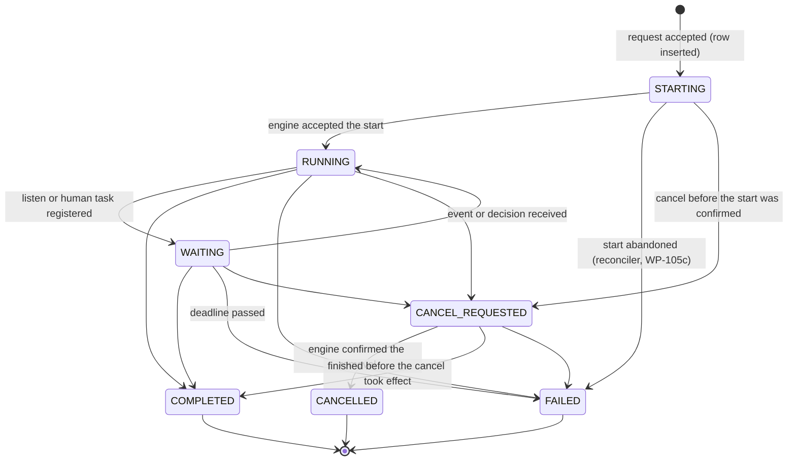
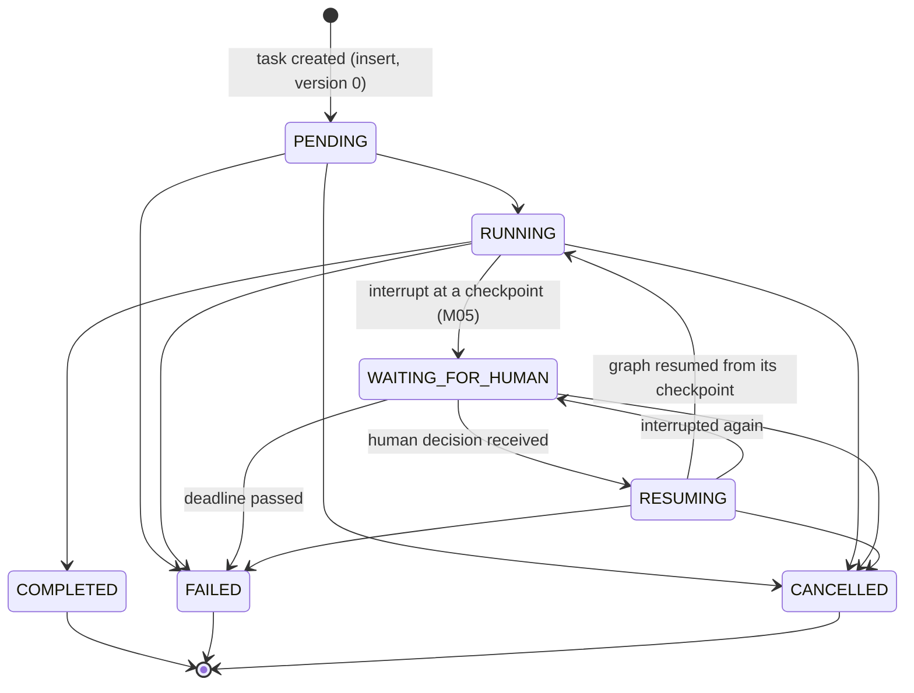
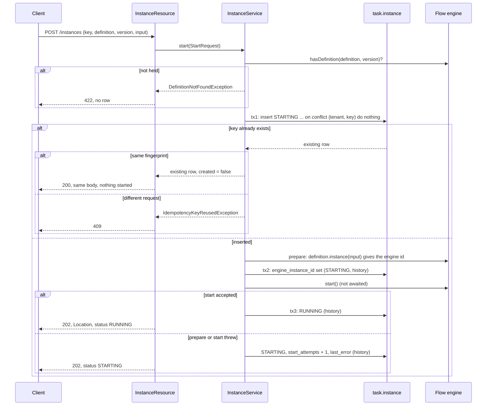

# Run lifecycle and the instance registry (WP-105, slice 105a)

**Status:** WP-105a and WP-105c implemented (105b and 105d not built; the reconciler is section 9) · **Decisions:** [ADR 0019](adr/0019-how-workflow-instances-are-started-queried-cancelled-and-resumed.md), [ADR 0020](adr/0020-checkpoint-scoping-and-state-evolution.md), [ADR 0023](adr/0023-workflow-to-agent-bridge.md) · **Plan:** [section 2, canonical progress](plan/README.md)

This slice makes the platform's own record of a run authoritative for lifecycle status, definition version and request idempotency. Quarkus Flow executes the pinned definition; it is not the record of what was asked for or what state the run is in. Slices 105b (outbox and projection), 105c (reconciler) and 105d (operations API) are not built here. Section 6 lists the seams they use.

## 1. Tables (schema `task`, migrations V10 to V13)

| Table | Row | Notes |
|---|---|---|
| `task.instance` | One workflow instance | Id is our ULID. Unique `(tenant, idempotency_key)` and unique `engine_instance_id`. Index on `(status, updated_at)` for the reconciler. |
| `task.agent_task` | One agent task (ownership row, ADR 0020) | Id is the task contract id. Unique `thread_name` (the derived `ThreadId`). FK to the instance. Holds the contract as JSON. `graph_version`, `state_schema_version` and `latest_checkpoint_id` are nullable and written by later slices. |
| `task.instance_event` | One history row per change of an instance | Primary key `(instance_id, version)`. `version` is the row version after the change, so history runs 0, 1, 2 with no gaps. |
| `task.agent_task_event` | One history row per change of an agent task | Same shape, keyed by `(agent_task_id, version)`. |

Every row has a `version` for optimistic locking. Both event tables are **append-only in the database**: a trigger refuses `UPDATE`, `DELETE` and `TRUNCATE` for any role (V13). A history row is written in the same transaction as the change it records.

Columns of `task.instance`: `id`, `tenant`, `owner_kind`, `owner_id`, `idempotency_key`, `request_fingerprint` (SHA-256 of the definition id, version and canonical input), `definition_id` (`namespace/name`), `definition_version`, `input` (JSON, at most 64 KiB), `status`, `engine_instance_id`, `start_attempts`, `last_error` (exception class name, never its message), `wait_deadline` (nullable, ADR 0019 Deadlines), `version`, `created_at`, `updated_at`.

## 2. State machines

Both are pure code in `io.github.bassemzohdy.openworkflow.agentic.runtime.lifecycle` (`InstanceStateMachine`, `AgentTaskStateMachine`). An illegal change throws `IllegalTransitionException`. A terminal state has no exit. A change that keeps the same status is not a transition: the store records it in history with `from` equal to `to` (used for a failed start attempt and for the engine id). `StateMachineTest` checks every pair of states against the edge list written out as literals.

### 2.1 Instance (registry) status

| State | Meaning |
|---|---|
| `STARTING` | Registered. The engine has not confirmed the start. A failed attempt keeps the row here with `start_attempts` and `last_error`. |
| `RUNNING` | The engine accepted the start. Waiting and completion are reported by the engine observer (105b). |
| `WAITING` | The instance waits for an event or a human decision. Written by 105b. |
| `CANCEL_REQUESTED` | A cancel was asked for; the engine removal is asynchronous (WP-003 Q05). |
| `CANCELLED`, `COMPLETED`, `FAILED` | Terminal. |

### 2.2 Agent task status

The contract's `AgentTaskStatus` names the states. `PENDING` is the created state and the only one a new row may have. `RESUMING` was added for ADR 0023 decision 7; `WAITING_FOR_HUMAN` keeps the name the contract already uses.

Why these states. `RESUMING` separates "interrupted, waiting for a decision" from "resumed and executing", so the reconciler can restart a resumed run after a crash without confusing it with a waiting one (ADR 0023). `WAITING_FOR_HUMAN` is entered only from `RUNNING` because an interrupt happens inside a step. `PENDING` has no direct edge to `WAITING_FOR_HUMAN` or `COMPLETED`: a task must run before it can wait or finish.

## 3. Start sequence (ADR 0019, Start)

Points that matter:

- **One engine start per key.** Only the request whose insert succeeded calls the engine. Concurrent identical requests wait on the unique key and then see the row. `ConcurrentStartTest` runs twenty threads through a barrier and asserts one row, one prepare, one start and three history rows.
- **The engine id is recorded before the engine runs anything.** `definition.instance(input)` already has the id, so tx2 stores it before `start()`. A crash after `start()` therefore leaves a row that names the engine instance the engine may already have persisted.
- **Our id, not the engine's.** The external instance id is our ULID, generated before the engine is involved, so that the idempotent insert can happen first. The engine id is kept in `engine_instance_id`. ADR 0019 says the engine's id is the external id; see section 7.
- **Start never waits.** `start()` is called and its future is not awaited. The request returns when the engine has accepted the instance.
- **Reads come from the registry only.** `GET /instances/{id}` never reads the Flow tables and returns 404 for another tenant's id.

## 4. REST contract

| Request | Response |
|---|---|
| `POST /instances` with `{definitionId, definitionVersion, input, idempotencyKey}` and headers `X-Tenant`, `X-Subject` | 202 and `Location` for a new instance; 200 with the same body for a repeated key; 409 for a key used with a different request; 422 unknown definition; 400 malformed; 401 no caller |
| `GET /instances/{id}` | 200 with `{id, definitionId, definitionVersion, status, engineInstanceId, startAttempts, version, createdAt, updatedAt}`; 404 unknown, malformed or another tenant's id; 401 no caller |

Errors are RFC 9457 problem documents with the correlation id. The caller comes from `CallerContextResolver`. It reads `X-Tenant` and `X-Subject` only when `agentic.dev.trust-caller-headers=true`. The default is false, so every instance endpoint answers 401 until WP-102 provides authentication. The flag must not be enabled in a deployment.

## 5. Failure modes

| Failure | What is stored | What happens next | Covered by |
|---|---|---|---|
| Definition not held by the engine | Nothing | 422; no row | `InstanceApiTest.anUnknownDefinitionIsRejectedAndNoRowIsCreated` |
| Same key, different request | Nothing changes | 409 | `InstanceApiTest.theSameKeyForADifferentRequest...` |
| Two identical requests at once | One row | One start; the other gets 200 | `ConcurrentStartTest` |
| Engine `prepare` throws | Row `STARTING`, attempt 1, `last_error` class, no engine id | 202 with `STARTING`. Repeats do not retry. The reconciler finds the row (WP-105c) | `EngineFailureTest` |
| Engine `start` throws | Row `STARTING`, engine id set, attempt 1, `last_error` | Same. The engine may have persisted the instance, so the reconciler must check before it starts again | `EngineFailureTest` |
| Registry write fails before the engine is prepared | Row `STARTING` may exist with no engine id, or no row | The response is 500 with the correlation id. The reconciler can find a `STARTING` row with no engine id and prepare it | not tested (fault injection, WP-110 and later) |
| Crash between tx2 and `start()` | `STARTING` with engine id, Flow has no instance | The engine id cannot be prepared again, and nothing in memory can be started. Each pass counts an attempt; at the limit the row is `FAILED` (`start.exhausted`) and the client resubmits with a new key. Section 9 | `ReconcilerRepairTest.aStartingRowTheEngineNeverHeardOfIsFailedAfterTheLimit` |
| Crash after `start()` but before tx3 | `STARTING` with engine id, Flow may have persisted it | Reconciler checks the engine. A running instance moves the row to `RUNNING`; a pending one is started. It never calls `prepare` again for that row | `ReconcilerRepairTest.aStartingRowTheEngineHoldsAsPendingIsStartedWithoutAnEpochChange` |
| Illegal status change | Nothing | `IllegalTransitionException`, no history row | `InstanceApiTest.anIllegalTransitionIsRejected...` |
| Stale version | Nothing | `StaleVersionException`, reload and decide again | `InstanceApiTest.aStaleVersionIsRejected...` |
| Edit of history | Refused by trigger | SQL error | `InstanceApiTest.historyIsAppendOnlyInTheDatabase` |
| Another tenant reads an id | Nothing | 404; the id is not revealed | `InstanceApiTest.anotherTenant...` |

Failure of a registry write after a successful engine start is the case that needs the reconciler most. The engine then runs an instance the registry does not show as running. That gap is closed in 105c, and until then the row stays `STARTING`, which is visible to any reader.

## 6. What slices 105b, 105c and 105d must add

Seams that exist now:

- `InstanceStore.replace` and `TaskStore.replace` are the only write paths. Each guards identity, version and transitions, and writes history in the same transaction.
- `JdbcTaskStore` implements `TaskStore`, so the runtime's ownership check is `findByThread` before any read, write or resume.
- `FlowWorkflowEngine` is the only class that calls Flow for start. Query and cancel for Flow go through the same adapter.
- The index `instance_status_updated_idx` supports the reconciler's scans.

**105b (outbox and projection)**
- Engine observer: write `WAITING`, `COMPLETED`, `FAILED` and `RUNNING` (resume) from engine events. No code in 105a writes these edges. They are in the state machine already.
- Transactional outbox: a row written in the same transaction as each history row. The writer is `JdbcInstanceStore.replace` and `JdbcTaskStore.replace`. Add a hook to the transaction so the outbox row and the history row commit together. 105a does not add it.
- `task_view` projection fed from the outbox, redelivered until acknowledged. The projection is never a source of truth.

**105c (reconciler, built: section 9)**
- Wait for definition warm-up at startup. Then, periodically and at startup: rows `STARTING` older than a threshold; rows `RUNNING` or `WAITING` whose engine instance is not active in memory, started through `activeInstance(id)` and `start()` (ADR 0019, resume; WP-003 Q02, Q11); rows `CANCEL_REQUESTED` that are stuck; `wait_deadline` passed.
- Agent runs in `RUNNING` or `RESUMING` restarted by the reconciler (ADR 0023, decision 7). Bridge A runs are restarted by the workflow instead.
- Every repair is audited. A repair never calls `prepare` for a row that has an engine id.
- Retries: set `quarkus.flow.http.client.resilience.retry.max-retries=0` (ADR 0019 Retries, ADR 0023 decision 3). Not done in 105a; it changes the behavior of the shipped definition's HTTP call and belongs with the reconciler's tests.

**105d (operations API)**
- Inspect, cancel, retry, pause and recover, authorized. Cancel moves `RUNNING` or `WAITING` to `CANCEL_REQUESTED`; retry applies to `STARTING` rows and the agent task states that allow it. Each call writes history with the operator as actor.
- Authorization depends on WP-102. Until then the endpoints are not exposed.

**Outside the four slices but needed by the plan**
- The code that inserts `agent_task` rows and sets `graph_version` and `state_schema_version` (WP-201, WP-302). `AgentTaskRecord` has no pinning fields, so the columns are written by SQL there, or the record is extended with a decision.
- Owner-scoped reads (who may read which instance). WP-102.

## 7. Deviations and open points for the owner

These are not ADR edits. The ADRs were left unchanged, as the brief asks.

1. **Our id, not the engine's, is the external id.** ADR 0019 says "The instance id is the engine's monotonic ULID, which we keep as the external id". The start has to insert a row before the engine is prepared so that the idempotency key is decided first, so the external id is ours. The engine id is stored in `engine_instance_id`. The owner should confirm this and amend ADR 0019.
2. **Engine id recorded before `start()`.** ADR 0019 Start lists the steps as insert, start, then record the id and set RUNNING. The Flow API gives the id from `definition.instance(input)`, before `start()`. Recording it first closes a gap after a crash. This is a refinement of the ADR's order.
3. **Query scope.** ADR 0019 says "a query by id is scoped by definition id and version; an id alone is not a valid key". With a platform ULID the id is unique on its own. `GET /instances/{id}` is scoped by tenant. Whether version scoping is still wanted needs a decision. Version pinning is recorded on the row either way.
4. **Input stored inline.** ADR 0019 allows "input reference or input". The input is stored inline as `jsonb`, limited to 64 KiB. Larger inputs need a reference, which is a later decision.
5. **Failed start is not `FAILED`.** A failed attempt stays `STARTING`. ADR 0019 does not say what happens after repeated failures. The state machine allows `STARTING -> FAILED`, reserved for the reconciler after it gives up.
6. **Pinning fields absent from `AgentTaskRecord`.** ADR 0020 decision 4 requires the agent task to record graph version and state schema version. The columns exist; the record in `oa-contracts` does not carry them. Adding them changes a public record, so this was not done in 105a.
7. **Retry configuration not applied.** ADR 0019 and ADR 0023 require the Flow HTTP client retry to be zero. Not configured in 105a (section 6).
8. **`RESUMING` added to `AgentTaskStatus`.** ADR 0023 uses the state name. The contract enum did not have it. It is additive, and no existing use changes.

## 8. Not verified

- No fault injection of a registry write between the engine call and the database; the failure rows are produced by the engine test double only.
- The real engine is used for start only. Whether the registry reflects the engine's later states is not tested, because 105b does not exist yet.
- The concurrency test uses twenty threads against one Postgres database on one machine; it shows the unique key works, not behavior under a multi-node deployment.

## 9. Reconciler (WP-105c)

Code: `Reconciler`, `EngineStatusSync`, `FlowEngineObserver`, `RegistryScan`, `RepairStore`, `AgentRunPolicy`, `LifecycleSettings`, `LifecycleFaults` in `oa-runtime`; the probe and its switches in `app-runtime`. Schema: V16 (`task.instance.resume_epoch`), V17 (`agent_task` bridge and lease), V18 (`task.repair_event`, append-only), V19 (wait-deadline index).

### 9.1 What Flow can and cannot report

| Topic | Observable | Used for | Evidence |
|---|---|---|---|
| Definitions warmed up and restored | Yes. Flow fires the CDI event `WorkflowApplicationReadyEvent` after warm-up. Its restore observes that event at the default observer priority. | The reconciler starts only after this event, observed at a later priority, so the restore has finished. A missing event is reported after `agentic.reconciler.warmup-timeout`. | Bytecode of `WorkflowApplicationInitializer` and `FlowPersistenceRestore` (1.2.0). Process test scenario A. |
| Restored instance | Yes, as active and PENDING, not started (WP-003, fact 1). `WorkflowDefinition.activeInstance(id)` returns it. | `startRestored` calls `start()` on it. | WP-003 Q02, Q11; process test scenario A. |
| Status transitions RUNNING, WAITING, COMPLETED, FAULTED, CANCELLED | Yes. Every CDI bean of type `WorkflowExecutionListener` is bound into the application when it is built (bytecode of `WorkflowApplicationCreator`). `onWorkflowStatusChanged`, `onWorkflowCompleted`, `onWorkflowFailed`, `onWorkflowCancelled`. | `FlowEngineObserver` feeds `EngineStatusSync`. | `FlowStatusSyncTest`: WAITING, COMPLETED and FAILED reach the registry with the reconciler off. |
| Persisted waiting status | No. Only SUSPENDED is written (WP-003, fact 2). | The observer is the only source of WAITING. | WP-003. |
| Completed or cancelled instances after the fact | No. The row is deleted (WP-003, fact 3). | A row whose engine instance is gone, with no report, stays as it is and is audited (`instance.absent`, `cancel.unconfirmed`). | WP-003; `ReconcilerRepairTest.aCancelTheEngineNoLongerHoldsWaitsForItsReport`. |
| Cancel timing | Asynchronous, about 100 to 250 ms (WP-003, Q05). | The registry records CANCELLED only on the engine's report. | `ReconcilerRepairTest.aStuckCancelIsSentAgainAndCompletesOnlyWhenTheEngineReports`. |
| Listen events | Not buffered (WP-003, Q02). | The reconciler never replays an event; the probe sends its event after WAITING. | WP-003. |
| Instance id seen by a task | Yes. HTTP tasks send `X-Flow-Instance-Id` (WP-003, Q10). | The probe looks up the epoch of the instance from this header. | `DevLifecycleResource`; process test scenario A. |
| SUSPENDED | Reported, no registry state. | Ignored. | `EngineStatusSyncMappingTest`. |

Not observable with Flow 1.2.0: whether a side effect inside a task completed when the process died (the task reruns, WP-003 Q11); completion versus cancellation of an instance the engine no longer holds. Both are handled by audit, not by guessing (see 9.9).

### 9.2 Repairs

| Condition | Action | Test |
|---|---|---|
| `STARTING`, no engine id, unchanged for `start-stale-after` | Prepare, record the engine id, start, record RUNNING | `ReconcilerRepairTest.aStartingRowWithNoEngineIdIsPreparedAndStarted`; process scenario B (kill after the insert) |
| `STARTING`, engine start threw | Count the attempt, keep the engine id, retry after backoff (doubling, capped at 10 minutes); the engine's instance is adopted if it exists | `ReconcilerRepairTest.aStartThatFailedOnceIsRetriedAndThenAccepted` |
| `STARTING`, engine holds the instance PENDING | Start it (no epoch change: the first start) | `ReconcilerRepairTest.aStartingRowTheEngineHoldsAsPendingIsStartedWithoutAnEpochChange` |
| `STARTING`, engine holds nothing for the engine id | Count the attempt; at `start-max-attempts` the row is `FAILED` with `start.exhausted`. Never prepared again. | `ReconcilerRepairTest.aStartingRowTheEngineNeverHeardOfIsFailedAfterTheLimit` |
| `RUNNING` or `WAITING`, engine instance PENDING (restored) | Increment `resume_epoch` (history row written), then `startRestored`. The task runs again with the new epoch. | `ReconcilerRepairTest.aPendingRestoredInstanceIsStartedAndItsEpochGoesUp`; process scenario A |
| `RUNNING` or `WAITING`, engine holds the instance in another state | Record the engine's status (poll; catches a missed report) | `ReconcilerRepairTest.theEngineStatusIsWrittenToTheRowThroughTheObserverPath` |
| `RUNNING` or `WAITING`, engine holds nothing | Audit `instance.absent` once an hour; status unchanged | Not covered by a test |
| Engine instance with no registry row | Audit `engine.unregistered`; not cancelled (9.9) | `ReconcilerRepairTest.anEngineInstanceNoRowRegistersIsReportedAndNeverCancelled` |
| `CANCEL_REQUESTED` unchanged for `cancel-reissue-after`, engine holds it | Send cancel again. Move to CANCELLED only when the engine reports it. | `ReconcilerRepairTest.aStuckCancelIsSentAgainAndCompletesOnlyWhenTheEngineReports` |
| `CANCEL_REQUESTED`, engine holds nothing | Audit `cancel.unconfirmed`; wait for the report | `ReconcilerRepairTest.aCancelTheEngineNoLongerHoldsWaitsForItsReport` |
| `WAITING` with `wait_deadline` in the past, engine holds it | Record `CANCEL_REQUESTED` first (so the engine's CANCELLED report finds it), then ask the engine to cancel | `ReconcilerRepairTest.aWaitPastItsDeadlineIsCancelledAndTheRequestIsRecordedFirst` |
| `WAITING` past its deadline, engine holds nothing | `FAILED` with `deadline.no-engine-instance` | `ReconcilerRepairTest.aWaitPastItsDeadlineWithNoEngineInstanceFailsTheRow` |
| Agent run `RUNNING` or `RESUMING`, lease missing or expired | `AgentRunPolicy`: bridge A or B left to the workflow; bridge C would be restarted, but no restarter is registered in 105c (WP-201); unknown bridge reported; live lease untouched. Audited as `agent.run`. | `AgentRunPolicyTest` (the rule). Not run against `agent_task` rows: there is no insert path yet. |

Every repair writes a row in `task.repair_event` (actor `agentic-runtime`). Conditions that repeat without change are audited once per hour per subject, not on every pass.

### 9.3 Locking and concurrency

- Each repair runs under a session advisory lock on the key of the registry row (first eight bytes of SHA-256 of `instance:<id>`). The lock is taken on a connection of its own and released after the repair. A reconciler that cannot take it counts `busy` and skips the row.
- The engine is never called while a row lock is held, and the lock never blocks the observer: the observer writes with the optimistic version check of `InstanceStore.replace`. On a stale version it reads the row again and plans again (`EngineStatusSync`).
- `InstanceService` keeps the state the observer recorded when `start()` returns late, and does not overwrite it (it returns the state it accepted).
- Test: `ReconcilerRepairTest.twoReconcilersNeverActOnTheSameRowAtOnce` holds one start in progress and runs a second reconciler: the second skips the row and no second engine instance is made.
- Scope: this covers reconcilers on one database. It does not stop two nodes from restoring the same live instance (9.9, item 1).

### 9.4 Warm-up

No sleep. The reconciler's startup pass is started by Flow's `WorkflowApplicationReadyEvent`, observed after Flow's restore. If the event does not come within `agentic.reconciler.warmup-timeout`, the state becomes `WARMUP_TIMED_OUT`, an error is logged, and no repair runs. The periodic pass starts after the startup pass and runs every `agentic.reconciler.interval`.

### 9.5 Settings

| Key | Default | Meaning |
|---|---|---|
| `agentic.reconciler.enabled` | `true` | Off in the boot tests (`%test`), which call `reconcileOnce()` themselves |
| `agentic.reconciler.interval` | `PT30S` | Pause between periodic passes |
| `agentic.reconciler.warmup-timeout` | `PT120S` | Wait for Flow's warm-up before giving up |
| `agentic.reconciler.start-stale-after` | `PT60S` | A `STARTING` row is repaired only when it has not changed for this long |
| `agentic.reconciler.start-max-attempts` | `3` | Engine start attempts before `FAILED` |
| `agentic.reconciler.start-backoff` | `PT5S` | Wait after the first failed attempt; doubles per attempt |
| `agentic.reconciler.cancel-reissue-after` | `PT30S` | A `CANCEL_REQUESTED` row is sent to the engine again after this time |
| `agentic.reconciler.wait-deadline` | `PT24H` | Wait given to a `WAITING` instance when the observer records it |
| `agentic.reconciler.batch-size` | `100` | Rows per page of the scans |
| `agentic.dev.fault.crash-at` | unset | Dev only: halt the process (`137`) at `after-insert`, `after-prepare` or `before-accept` |
| `agentic.dev.lifecycle-probes` | `false` | Dev only: expose `/dev/lifecycle/*` (probe effect, event injection). Never in a deployment. |

### 9.6 Entry points for 105d

Java methods on `Reconciler`, to be exposed by the operations API with its own authorization:

- `retry(tenant, instanceId)`: starts a `STARTING` row now, skipping the staleness and backoff checks.
- `recover(tenant, instanceId)`: repairs one row by its status, as a pass would, without the staleness checks.
- `reconcileOnce()`: one full pass.

Each returns counts. The operator's identity is not recorded by these methods; 105d must write its own history with the operator as actor before it calls them. No HTTP endpoint exists in 105c.

### 9.7 The resume epoch seam (WP-108)

`task.instance.resume_epoch` counts the restarts the reconciler performed. It is incremented before `startRestored`, so the task that runs again sees the new value. A task reads it from its engine instance id through `RegistryScan.resumeEpochOfEngineInstance`. In YAML, the probe sends the engine id in `X-Flow-Instance-Id` and the endpoint looks the epoch up. Whether a YAML expression can read the epoch directly was not tested; the call above is the verified path. WP-108 keys its effect ledger on (engine instance id, epoch, node id).

### 9.8 HTTP retry rule

`quarkus.flow.http.client.resilience.retry.max-retries=0` is set in `app-runtime/src/main/resources/application.properties`. `FlowStatusSyncTest.aFailedEffectIsRecordedAsFailedAndTheCallIsNotRetriedByTheClient` shows one call to a failing endpoint. `FlowHttpRetryDefaultTest` runs the same flow with the Flow default of three retries and shows more than one call, so the property has the effect. The default retries also repeat a 500 response, which ADR 0019 does not say.

### 9.9 Limits

1. **Two nodes may restore one live instance.** A node that restarts restores every instance in the Flow tables, including one another node is still running. The reconciler's locks do not prevent this. The fix is a lease held by the running node, which is WP-109 (failover). Single-node resume is the only case verified.
2. **Unregistered engine instances are reported, not cancelled.** An engine instance carries no tenant or idempotency key, so cancelling it by its input could cancel another tenant's identical request.
3. **Completion and cancellation of an instance the engine no longer holds are not decided.** The registry keeps the row and audits it. Only the engine's report decides, and Flow does not keep that report after the row is deleted.
4. **Deadlines use the platform default.** `agentic.reconciler.wait-deadline` is recorded when the observer sees WAITING. The definition's own timeout is not read; Flow's timeout remains a second guard. A deadline with no engine instance is set `FAILED`, which assumes the instance did not complete unobserved.
5. **Agent runs are decided, not restarted.** `AgentRunPolicy` is the rule. There is no `agent_task` insert path, no lease writer and no restarter yet (WP-201). The rule is not exercised against rows.
6. **The window between the engine id and `start()` cannot be repaired by re-preparing.** The engine id is fixed once recorded, and the prepared object is in memory only. The row fails after the attempt limit.
7. **The unregistered-instance report can name an instance that was just prepared** and is not yet recorded. It is an audit row, not an action.
8. **Dev switches.** `agentic.dev.fault.crash-at` and `agentic.dev.lifecycle-probes` exist for tests. They are off by default and must never be set in a deployment.

### 9.10 Verification

Commands, run from the worktree root with `DB_URL=jdbc:postgresql://localhost:5432/wp105c`:

- `mvn -B verify`, the full build, including the `*IT` process tests (`LifecycleRecoveryIT`).
- `python3 tools/check_dependency_policy.py`, `python3 tools/render_requirements.py --check`, and the generator check from `docs/testing.md`.

The results are recorded in the report that accompanies this slice, with the output lines of each command.

### 9.11 ADR statements that are wrong or incomplete

These are for the owner. The ADRs were not edited.

- ADR 0019, Cancel: "a reconciler moves rows stuck in `CANCEL_REQUESTED`". This is incomplete. When the engine holds no instance and sends no report, CANCELLED and COMPLETED cannot be told apart, and the ADR needs a rule for that outcome.
- ADR 0019, Deadlines: says the reconciler enforces the deadline without saying how. Implemented: record the request, then cancel the engine instance; `FAILED` when the engine holds nothing.
- ADR 0019, Start: records RUNNING after `start()` returns. The engine's report can arrive first, so the registry follows the engine's report when both happen. The ADR should say so.
- ADR 0019, Resume: the epoch must be incremented before the restart for WP-108 to key on it. The ADR does not say this.
- ADR 0019, Retries: states the rule for the OWS retry. It does not say that the Flow default also repeats a 500 response (9.8).
- ADR 0023, decision 7: requires the reconciler to restart agent runs "recorded as RUNNING or RESUMING", but does not define when such a run is no longer alive. 105c adds the lease columns for that (V17); the agent path that writes them does not exist yet.
- ADR 0019, Query: "scoped by definition id and version" is still open (section 7, item 3).

### 9.12 Deviations from the brief

- The probe definition ships under `app-runtime/src/main/resources/flow`, not under `src/test`. Flow reads definitions at build time, so a test-only copy cannot reach the packaged child process the process test runs.
- The 105a boot tests start the probe definition instead of `research-and-approve`. The latter calls an agent endpoint that does not exist here and fails within milliseconds, which made its status race the tests once the registry follows the engine.
- `%test.quarkus.http.test-port=0` replaces the fixed test port (8081), so parallel Maven runs do not collide.
- The observer covers the engine transitions the brief put in 105c (WAITING, RUNNING, COMPLETED, FAILED, CANCELLED). This overlaps the engine observer that 105b was given; the two branches will conflict in `FlowWorkflowEngine` and `InstanceService`, and 105b should build on this one.
- `retry` and `recover` are Java entry points only, as the brief asked.
